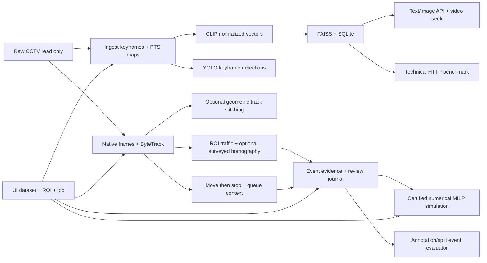

# Báo cáo kỹ thuật đồ án CCTV — VGU Explore Computer Science

Ngày lập: 2026-10-01. Phạm vi: baseline demo trên Windows 11 Native,
PowerShell, RTX 4070 Laptop 8GB. Cập nhật hiện hành 2026-10-03: năm giới hạn
kỹ thuật đã được xử lý trong phạm vi nêu ở mục 3–4; T10.8/M11 tại commit
`bcc8e64` và latency T6.2/T7.3/T9.4 bên dưới là bằng chứng lịch sử gắn phiên bản.
Chưa nghiệm thu chạy máy Windows vật lý thứ hai hoặc chất lượng trên nhãn độc lập.

## 1. Bài toán và kết quả hiện có

Hệ thống truy hồi keyframe CCTV để người dùng tìm và mở video tại thời điểm
tương ứng, quan sát thống kê giao thông, xem ứng viên sự kiện và thử gợi ý
phân bổ nhân lực. Kiến trúc phát triển từ pipeline/index/API kế thừa thay vì
viết lại: giữ keyframe naming, CSV map, SQLite frames và ID FAISS.

Đã chạy được text/image retrieval, video seek, detector xe, tracking clip,
traffic windows, đóng gói evidence và review, rule nghi sự cố,
solver nhân lực mô phỏng, event evaluator và phép đo HTTP latency.
M11 cho phép chọn demo/upload video, gán camera/ROI, chạy pipeline, review
demo, tính proposal và tải báo cáo trong một UI; mở bằng `Open-CctvDemo.cmd`.
Tuyến T10 bổ sung nút tự kiểm chứng kết quả đã có, năm bước kỹ thuật,
dừng/retry và report JSON/Markdown trong ZIP. Smoke browser đã đạt 5/5,
dừng/retry cùng job và tải báo cáo thành công; 268 core tests Windows đạt tại
rehearsal T10 trước các thay đổi hiện hành, không phải số full suite mới.
Đây là kiểm tra khả năng xử lý demo; chất lượng footage vẫn chưa đo,
M8 pending và máy thứ hai NOT_RUN.
Chưa có multimodal fusion OCR/ASR cho CCTV hoặc hệ thống
nhận diện tai nạn đã kiểm định. Các kết quả này là nền demo có thể kiểm thử.

## 2. Dữ liệu và phạm vi thực nghiệm

Sáu video gốc từ hai camera N001/N002 được người dùng xác nhận; manifest:
`configs/cctv.demo.json`. Raw nằm ngoài repo tại `D:\Project ExploreCS\Demo_Data`,
chỉ đọc. Chưa biết vị trí camera, thời gian tuyệt đối hoặc recording groups.
Không suy các thông tin này từ tên file/overlay. Hai ROI draft vẫn pending.

| Đối tượng | Quy mô đã chạy | Giới hạn diễn giải |
| --- | ---: | --- |
| Ingestion/retrieval | 7.232 keyframe, khoảng 2 FPS | Không dùng chuỗi keyframe này thay tracking native FPS |
| Detection keyframe | 150.204 bounding boxes | Không phải số xe duy nhất hoặc lưu lượng thực |
| Tracking | 6 clip `[30,40)`, 12 segment 5 giây, 1.501 frame | Chỉ 60 giây camera-time; không đại diện toàn bộ footage |
| Track observations/IDs | 31.065 observations, 1.001 scoped IDs | ID có scope run/video/segment, không phải unique vehicles |
| Traffic | 30 window 2 giây, 0 candidate | Ngưỡng chưa hiệu chỉnh; không chứng minh không có tắc đường |
| Rule nghi sự cố | 0 candidate trên sáu clip | Không chứng minh video không có tai nạn |
| Event labels | 6 interval pending; split unassigned | Chưa đủ điều kiện tính quality metrics |

Smoke M11 dùng **một video test-pattern H.264 tổng hợp riêng**, 12 giây,
không cộng vào sáu MOV hay dùng để đánh giá detector: 24 keyframes/index 768D,
tracking 10 giây/250 frames/2 segments, 5 traffic windows và MP4 overlay.
Job hoàn tất 12/12 stage. ROI pending, thresholds_calibrated=false và
operational_ready=false. Case tổng hợp được review needs_more_evidence;
proposal có 0 assignment/1 unmet. Kết quả chứng minh luồng phần mềm chạy,
không chứng minh nhận diện sự cố hoặc tắc đường chính xác.

## 3. Kiến trúc và cơ sở thiết kế

CLIP dùng revision cố định, một instance theo stage, FP16/autocast trên CUDA;
vector chuẩn hóa FP32. Với hai vector đơn vị, inner product bằng cosine:
`cos(u,v) = u·v / (||u|| ||v||) = u·v`. FAISS `IndexIDMap2(IndexFlatIP(768))`
tìm chính xác, tránh thêm tham số approximate index khi baseline chỉ 7.232 ảnh.
Cosine score không phải xác suất tai nạn. SQLite mở `mode=ro` khi retrieval.
Text query hiện có expansion 19 cụm từ CCTV Việt–Anh; API/CLI embed prompt
English đã chuẩn hóa và API cho thấy `translated_prompt`. Đây không phải
dịch tiếng Việt tổng quát; chất lượng relevance song ngữ chưa được đánh giá.

Keyframe map giữ PTS tương đối frame giải mã đầu tiên và ordinal 0-based.
ByteTrack chạy trên frame native liên tiếp và vẫn reset ID theo segment để
giữ checkpoint/bộ nhớ bounded; tránh suy motion từ sampling 2 FPS. Stitching
hậu xử lý **tùy chọn** dùng hình học, vận tốc/PTS, lớp và bbox để nối tracklets,
không sửa ledger gốc; overlay có thể đọc derived global IDs. Không phải visual
re-ID đã kiểm định hay bằng chứng đếm xe duy nhất chính xác.
Count sử dụng điểm tham chiếu box trong ROI; occupancy union tránh đếm chồng
diện tích. Motion pixel/giây vẫn có; `median_speed_kmh` chỉ có khi cung cấp
calibration ground-plane homography từ điểm đường đo thực, trong vùng hiệu lực.
Không có calibration thì km/h null, không đổi pixel/s thành km/h giả.
N001/N002 trong `configs/cctv.calibration.demo.json` vẫn pending, không có điểm
khảo sát. Homography giả định mặt đường cục bộ phẳng; ngưỡng/persistence vẫn
chưa hiệu chỉnh trên development có nhãn độc lập.

Move-then-stop dùng lịch sử scoped track và PTS, reset khi gap/ID/ROI/segment
không hợp lệ. Queue-context lọc dừng đồng bộ/nhập hàng xe và xét lại khi các xe
lân cận rời đi; giảm confounder hàng xe/đèn đỏ nhiều xe trong fixtures.
Một xe chờ đèn đỏ đơn lẻ vẫn có thể tạo ứng viên. Output vẫn là
`suspected_road_incident`, cần review, không kết luận tai nạn tự động.

Dispatch chỉ chạy với zone/team/travel mô phỏng. Sparse binary MILP hỗ trợ
tối đa **100 team × 100 demand**, tối ưu lexicographic priority, travel, staff
và tie-break xác định; giữ whole team, skills, allowed zones, cap và reserve.
Mỗi stage phải có HiGHS optimal/zero-gap và certificate được kiểm tra bằng
số nguyên; đây là chứng nhận tối ưu **số học**, không phải chứng minh ký hiệu.
Travel decimal được scale chính xác; tổng integer conservatively bounded
`2**40`, từ chối precision/range không biểu diễn an toàn, không âm thầm làm tròn.
Thiếu SciPy hoặc precision guard chỉ được fallback DP legacy khi **cả team và
demand ≤12**, có cảnh báo; lớn hơn hoặc certificate thất bại thì fail closed,
không publish proposal một phần. Event source lấy trạng thái từ review journal,
không tin review_status request tự khai. Không gửi lệnh điều động thực.

M11 gọi lại các CLI hiện có bằng worker local, một job tại một thời điểm.
CLIP phục vụ được giải phóng trước index/tracking và nạp lại khi hoàn tất.
Upload được sao chép vào output riêng; raw demo có sẵn vẫn chỉ đọc. Mỗi run
có cấu hình riêng và checkpoint của từng stage; retry giữ recipe cũ. Review
UI dùng revision guard, proposal dùng journal/nguồn lực hiện tại. M8 vẫn
pending: review demo một người không thay thế nhãn độc lập.

### Giới hạn kỹ thuật đã xử lý và ranh giới chưa thể nghiệm thu

| Thành phần | Đã triển khai/kiểm chứng kỹ thuật | Ranh giới còn mở |
| --- | --- | --- |
| Nghi sự cố | Queue-context cho collective stop/queue; re-evaluate khi queue rời | Xe đơn lẻ chờ đèn đỏ vẫn confounder; chưa có FP/FN footage độc lập |
| Tracking | Stitching hình học tùy chọn qua segment, giữ scoped ledger gốc | Không visual re-ID; chưa kiểm định identity/count quality hoặc continuity mọi trường hợp |
| Tốc độ | Homography metric và km/h khi có surveyed calibration | N001/N002 chưa đo; km/h null; mặt đường không phẳng/điểm ngoài vùng chưa được đảm bảo |
| Retrieval | 19-term Việt–Anh expansion, prompt hiển thị | Không general translation; chưa relevance labels/Recall@K/MRR song ngữ |
| Dispatch | 100×100 MILP với guard/certificate, warned legacy fallback ≤12 | Travel/resources mô phỏng; numerical certificate không symbolic proof; timing benchmark không SLA 1 giây |
| M8 / T10.4 | Forms, blind notes, comparison, adjudication/export có gates | Cần **hai người thật độc lập**; một người/hai tên không tạo ground truth |
| T10.2 / T10.3 | ROI/split contracts, source binding và leakage guards | Người thật duyệt góc nhìn/ROI; xác nhận recording groups trước group-level split |
| T10.5 / T10.6 | Calibration/evaluator tooling | Đo markers thực; labels/ROI/split đủ gate để hiệu chỉnh development và chấm frozen test |
| T10.7 | One-command environment/source/CUDA/core verification package | Cần Windows host vật lý khác và người xác nhận full-process/UI; hostname khác không chứng minh hardware khác |

Không phần mềm nào tạo thay reviewers, survey, ROI approval, recording evidence
hay quyền truy cập host vật lý. `quality_metrics=null`, M8 `PENDING`,
`operational_ready=false` vẫn áp dụng; không tự nâng gate từ synthetic smoke.

## 4. Kiểm thử và đánh giá

Các module dùng contracts có version, output riêng, checksum publication,
checkpoint/resume và kiểm tra input overlap. Kiểm thử gồm schema lỗi,
interruption, corruption, native PTS, locator joins, review CAS/hash chain,
matching và solver oracle. Core suite T6.2: **182 tests đạt**, pip check và
CUDA FP16/NMS đạt; không tuyên bố full legacy suite đã đạt.
Sau bổ sung exporter T6.3, core suite đạt **189 tests**; package evidence
được kiểm tra source binding, corruption, raw protection và no-op resume.
Tại M11, Windows core suite đạt **264 tests**, pip check/compile/CUDA FP16/NMS
đạt; 25 focused tests đạt. Không chạy lại inference hoặc core suite chỉ để
cập nhật tài liệu T10.8. Browser kiểm tra text query trả 12 kết quả, mở video
seek giây 8/duration 12/readyState 4, traffic và review gate, tải ZIP. Native
file chooser qua extension chưa kiểm chứng vì thiếu quyền file URL;
upload HTTP/backend được kiểm thử bằng file thật.

Baseline lịch sử dùng 10 quỹ đạo synthetic, gồm trường hợp đèn đỏ tạo false
alarm. Kiểm chứng hiện hành có 22 incident tests và smoke collective stop
3→0 ứng viên, isolated stop vẫn 1; không phải accuracy CCTV. Event evaluator
kiểm tra temporal IoU 0,1/0,3/0,5, matching exact
max-total-IoU, precision/recall/F1, false alarms/reviewed camera-hour và delay
theo source PTS. Fixture TP=1/FP=2/FN=1 chỉ kiểm tra phép tính; không phải
accuracy trên CCTV. Thực nghiệm thật trả `NOT_EVALUATED_NO_REVIEWED_INTERVALS`,
metrics=null và split_ready=false.

Các phép kiểm chứng thay đổi hiện hành: stitching 45 tests; six-MOV sampled
publication có 11.453 tracklets → 8.596 derived IDs, 2.857 links và 72.011
observations (chỉ hình học, **không validated re-ID**). Calibration/overlay
52 tests; synthetic 40 km/h, uncalibrated null; UI thật tách px/s và km/h
unavailable, UI synthetic hiện 40/0. Bilingual 27 tests; CPU CLIP thật cho
VI/English cùng top-12, API thấy prompt; đây là parity kỹ thuật, không relevance.
Dispatch/resources/API 48 tests; CLI scenario 25 team/demand cho 25 assignments,
0 unmet; SciPy 1.17.1, ba lần allocate 0,891/0,404/0,412 giây, median 0,412 giây,
và scenario 10×10 parity với legacy. Không suy mọi 100×100 scenario dưới 1 giây.
Chưa có số full core suite mới trong bản cập nhật này; giữ các counts lịch sử.

HTTP benchmark T6.2 đóng băng config, index/model/code, ảnh query và session
server. 6 text + 6 image query, top-k=12, 2 warmup và 10 samples/query,
concurrency=1: 24 warmup, 120 request đo, không lỗi.

| Loại query | Samples | P50 (ms) | P95 (ms) | Mean (ms) |
| --- | ---: | ---: | ---: | ---: |
| Text | 60 | 52,66 | 56,43 | 52,94 |
| Image | 60 | 127,91 | 141,34 | 129,30 |

Khoảng đo là client HTTP wall time nhận toàn response, gồm preprocessing,
inference, retrieval và transfer; loại đọc ảnh, JSON validation, warmup và
cold start. P95 là empirical linear quantile; mẫu nhỏ, tải tuần tự và client
khác không bị chặn, nên không khẳng định SLA hoặc khả năng nhiều người dùng.
Ảnh query lấy từ index để kiểm thử API, không cung cấp relevance labels;
Recall@K/MRR vẫn null. Allocator peak toàn phiên model: allocated=843,79 MiB,
reserved=862 MiB; không phải tổng VRAM Windows hoặc peak riêng request.

Mô phỏng phân bổ: roster 6, available 4, reserve 2, dispatchable cap 2.
Solver gán SIM-TEAM-A (2 người) cho demand priority 4; giữ 2 người dự phòng,
2 demands unmet do review gate/shared cap. Event package thật rỗng tạo
0 assignment; synthetic case ở needs_more_evidence cũng bị gate chặn.

## 5. Bằng chứng và tái lập

| Nội dung | Artifact cục bộ / tài liệu kiểm tra |
| --- | --- |
| Manifest/index | `configs/cctv.demo.json`, `outputs/demo-data/search-index/index_state.json` |
| Detection/tracking | `outputs/demo-data-review/detection-verification.json`, `tracking-verification.json` |
| Traffic/incidents | `outputs/demo-data-review/congestion-verification.json`, `incident-verification.json` |
| Allocation lịch sử | `outputs/demo-data/dispatch-simulation-v1/dispatch_report.json`; sealed dispatch-v1 không còn là input hiện hành sau cutover v2, phải dựng output mới theo handover |
| Event quality pending | `outputs/demo-data/event-benchmark-pending-v1/benchmark_report.json` |
| HTTP latency | `outputs/demo-data/runtime-benchmark-v1/runtime_report.json` |
| Core tests | `outputs/tests/core-tests.txt`; log này được cập nhật sau mỗi task |
| UI workflow M11 | `docs/CCTV_UI_WORKFLOW.md`, commit `bcc8e64`, `outputs/tests/m11-final-focused.txt` |
| M11 job và counts | `outputs/ui-workflow/3c2df27735c74e33b9c289d858e560a2/job.json`; run `run-44a2269e348f4553ae3cc40599a11cf0` |
| Stitching hiện hành | `outputs/tests/limits-step2-tests.txt`, `outputs/tests/limits-stitched-real-current/stitch_state.json` |
| Calibration/bilingual | `outputs/tests/limits-step3-tests.txt`, `outputs/tests/limits-step4-tests-final.txt` |
| MILP hiện hành | `outputs/tests/limits-step5-tests-final.txt`, `outputs/tests/limits-milp-benchmark.json` |

Tài liệu triển khai theo module nằm trong `docs/CCTV_*.md`; tiến độ hiện hành
trong [CCTV_PROGRESS.md](CCTV_PROGRESS.md). Git history ghi Conventional
Commits; commit T6.2 là `c6063a1`. Outputs/media/models không đưa lên Git.
[CCTV_HANDOVER.md](CCTV_HANDOVER.md) có one-command
`scripts/Test-SecondMachineHandover.ps1`, tuyến dựng lại stage và exporter.
Tooling rehearsal cục bộ đã đạt tại `outputs/limits-handover-verified/`:
347 tests/1 skip (OS không cho tạo directory symlink), pip check/compile/CUDA
FP16/NMS đạt; 10 ZIP members/archive SHA verified. Raw và code snapshot giữ
integrity trong lượt chạy; không có physical second-host run.

Smoke lịch sử `limits-e2e-smoke.json` cần standalone indexing/retry sau native
access violation `3221225477`. Probe tiếp theo đo commit exhaustion Windows1455;
private commit của native pools và Torch process còn giữ là yếu tố tài nguyên.
Đã chuyển serving CLIP sang process có ownership và giới hạn mặc định native
pools Windows hai threads; không thay weights/FP16/loader hoặc OS/pagefile.

Smoke mới `outputs/tests/m11-cold-smoke.json`: fresh browser upload H.264
test-pattern 12 giây, pending ROI/toàn video 2 FPS; **12/12 stages lần đầu**,
không recovery. 24 index/tracking frames, 6 windows; text/image UI trả 12 kết quả,
source/overlay readyState=4. Report button HTTP200, ZIP 34 members/CRC đạt;
uploaded source SHA/mtime giữ nguyên. Lifecycle GPU riêng xác nhận process exit
trước loader mới và text/image vectors max error=0 với loader trực tiếp.
44 focused tests đạt; full Windows verification chạy 353 tests, 352 passed/1 skipped
(OS không cho directory symlink), pip check/compile/CUDA FP16/NMS đạt. Logs:
`outputs/tests/m11-process-focused.txt`, `m11-process-core-tests.txt`, `m11-regression.json`.
Không suy thành real accuracy hoặc physical second-host acceptance; mapping
exhaustion là giải thích source-backed cho fault cũ, chưa có native dump.
Chi tiết/current gates: [progress](CCTV_PROGRESS.md).

## 6. Công việc tiếp theo

Nghiệm thu trên máy thứ hai với commit, cấu hình và log riêng; duyệt ROI,
xác nhận recording groups để chống leakage; tạo nhãn relevance/event độc lập
và reviewed coverage; hiệu chỉnh ngưỡng trên development rồi đánh giá test.
Sau đó mới so sánh baseline và phân tích lỗi có nhãn. Event/dispatch UI và
full-process demo UI đã có; dữ liệu vị trí/nguồn lực thực không phải điều kiện
cho demo. Hiện nghiệm thu kỹ thuật cục bộ; T10.1 content/groups, T10.2 ROI,
T10.3 split, T10.5 calibration, T10.6 quality và T10.7 máy thứ hai còn pending.
T10.4/M8 giữ pending theo người dùng. T10.8 đã chuẩn bị báo cáo và kịch bản
bảo vệ demo dưới đây; bổ sung kết quả đánh giá/tái lập khi chúng thực sự có.

## 7. Kịch bản bảo vệ demo — khoảng 10 phút

Rehearsal kỹ thuật bằng browser đã chạy ngày 2026-10-01 trên commit `b44120a`,
dataset đã xử lý **M11 browser smoke**. Chưa có rehearsal thuyết trình bởi
người dùng hoặc buổi bảo vệ; không đo thời lượng thuyết trình 10 phút.
Trước buổi trình diễn, kiểm tra môi trường đã setup, weights có sẵn, cổng
launcher không bị ứng dụng khác chiếm và demo H.264 đủ dài cho tracking.
Chạy pipeline trước trên UI nếu buổi bảo vệ ngắn; không hứa hoàn tất inference
trong một thời lượng cố định. Có thể dùng dataset đã xử lý để trình diễn kết quả.

| Thời gian | Thao tác trên một UI | Nội dung trình bày |
| --- | --- | --- |
| 0–1 phút | Mở launcher và panel workflow | Bài toán CCTV, kế thừa kiến trúc, phạm vi demo |
| 1–3 phút | Chọn demo/upload; camera, ảnh ROI, khoảng 10 giây, lưu | Raw chỉ đọc; ROI draft; toàn video cho keyframes, clip cho tracking |
| 3–4 phút | Chạy hoặc mở dataset đã hoàn tất; progress/log/retry | CLI được tái sử dụng, GPU tuần tự, checkpoint |
| 4–6 phút | Text query Việt/Anh, xem translated prompt, mở keyframe/video | 19-term expansion + CLIP/FAISS/SQLite; seek bằng PTS, score không là xác suất |
| 6–7 phút | Traffic timeline, ROI, bbox/ID overlay | px/s; N001/N002 km/h unavailable; optional geometric IDs không validated re-ID |
| 7–9 phút | Case tổng hợp, review needs_more_evidence, tính proposal | Evidence/revision; pending gate chặn phân bổ; đội/budget/reserve mô phỏng |
| 9–10 phút | Tự kiểm chứng T10, tải ZIP và trình bày giới hạn | Bằng chứng demo lịch sử pipeline 12/12, T10 5/5; số tests theo log của run, quality/M8/physical second-host pending |

Nếu muốn minh họa assignment, chọn kịch bản **Nhu cầu tổng hợp** trong tab
phân bổ: fixture có 1 assignment/2 unmet. Không xác nhận một sự cố demo chỉ
để tạo assignment. Nếu cần thao tác dừng/retry, làm rehearsal riêng trước;
giữ checkpoint và không xóa output để tạo lỗi giả.

### Câu hỏi dự kiến và trả lời dựa trên bằng chứng

- **Hệ thống đã nhận diện tai nạn chưa?** Chưa có đánh giá nhãn độc lập.
  Queue-context giảm false alarms collective stop; xe đơn lẻ chờ đèn đỏ vẫn
  có thể tạo ứng viên. Đây là sàng lọc nghi sự cố, không classifier tai nạn.
- **Tại sao lấy keyframe 2 FPS nhưng tracking dùng native frames?** Retrieval
  giảm số ảnh cần index; tracking cần chuỗi liên tiếp và PTS để đo motion.
- **Tại sao dùng exact FAISS?** Baseline 7.232 ảnh/768D đủ nhỏ; vectors chuẩn
  hóa cho cosine qua inner product, chưa cần approximate index.
- **8 GB VRAM có đủ không?** Luồng hiện đã chạy trên RTX 4070 Laptop, FP16,
  batch CLIP 4, tracking bounded và một model GPU theo stage. Không suy rằng
  mọi model/dataset hoặc nhiều users đồng thời đều chạy được.
- **Tests có nghĩa accuracy cao không?** Chỉ kiểm thử phần mềm/contracts.
  268 là count rehearsal T10 lịch sử; chưa có F1/Recall@K thực, latency cũ
  không là latency các thay đổi hiện hành.
- **Đề xuất phân bổ có dùng được cho cảnh sát thật không?** Nguồn lực/vùng/
  travel giả định; solver minh họa constraints và reserve, không phát lệnh.
- **Tái lập đã được chứng minh trên máy khác chưa?** Chưa. T10.7 vẫn NOT_RUN;
  checklist yêu cầu pinned commit, môi trường, raw hashes và log thực.

Các mục bổ sung dưới đây là lịch sử từng task; mô tả “chỉ đọc” của T7 không
phải giới hạn của workflow M11 hiện tại.

## Cập nhật sau bàn giao: T7.1

Demo đã có tab Sự kiện & evidence chỉ đọc: event v1/v2, review state/revision,
case synthetic riêng và mở native-PTS evidence trong video. Core suite đạt
194 tests. Dispatch UI và việc ghi review qua UI vẫn còn mở; latency trong
mục 4 là phép đo code T6.2, chưa đo lại code API T7.1.
## Bổ sung T7.2 — phân bổ mô phỏng trên UI

T7.2 nối báo cáo T5.2 vào GET API/tab Phân bổ mô phỏng. Màn hình hiển thị
roster, nhân lực sẵn sàng, cap, dự phòng, đội đã xếp và lý do unmet. Adapter
đối chiếu checksum/config/event/journal với inputs hiện tại và kiểm tra khả
thi; request không chạy solver hoặc nạp thêm model. Journal/config đổi sẽ
làm báo cáo cũ chưa khả dụng, cần output mới từ CLI.

Bộ Windows hiện đạt 202 core tests, pip check, compile, CUDA FP16/NMS.
HTTP demo thật có ba gói: simulation 1 assignment/2 unmet, events_empty 0/0,
review_gate 0/1. Simulation xếp 2 người và giữ dự phòng 2; review gate còn
`needs_more_evidence` revision 3, không được phân bổ. 68 artifacts/configs
giữ SHA/mtime sau HTTP; browser kiểm tra ba kịch bản và Home/End, console
không lỗi. Chi tiết: `CCTV_DISPATCH_UI.md` và output verification local.

Đây vẫn là nguồn lực/tình huống mô phỏng. Không ghi review hoặc phát lệnh điều
động; chưa nghiệm thu chất lượng phát hiện sự kiện hoặc phân bổ thực tế.
T7.3 kiểm thử demo đầu-cuối và đo lại runtime của code mới; phép đo
T6.2 vẫn chỉ đại diện phiên bản code tại thời điểm đo.

## Bổ sung T7.3 — nghiệm thu kỹ thuật demo cục bộ

CLI nghiệm thu HTTP đã có, đọc metadata SQLite độc lập và kiểm tra UI assets,
text/image, ảnh/video Range, traffic, event và review-bound dispatch.
Report cuối `outputs/demo-data/acceptance-t7-v2/acceptance_report.json` kiểm
tra raw/config/index/code/assets giữ SHA/mtime. Browser xác minh tìm kiếm
trả 12 kết quả và mở video tại 488,014 giây, traffic 30,037 giây, event
35,996 giây; video readyState=4, review gate 0 assignment/1 unmet, console
không lỗi. Đây là checks chạy thử, không phải nhãn chất lượng.

Benchmark mới `runtime-benchmark-t7-v1`: 24 warmup và 120 request đo, lỗi=0.
Text P50/P95 49,76/53,78 ms; image 147,91/167,64 ms. Model-lifetime allocated
peak 851,91 MiB, reserved 862 MiB. Cùng workload/model/index với T6.2 nhưng
khác phiên đo; không kết luận tác động nhân quả của UI lên hiệu năng.
Resume hoàn chỉnh giữ hai report/checkpoint SHA/mtime. Bộ Windows đạt 208
core tests, pip check/compile/CUDA FP16/NMS đạt.

M7 đã đạt nghiệm thu kỹ thuật cục bộ; chất lượng retrieval/event, ROI và
calibration, vị trí/nguồn lực thật, chạy trên máy thứ hai vẫn chưa nghiệm thu.
Quy trình/lệnh đầy đủ: `CCTV_DEMO_ACCEPTANCE.md`.

## Bổ sung T8.1 — chuẩn bị tư liệu review, chưa tạo ground truth

Bundle pending đã có 36 JPEG sạch nguyên bản từ sáu khoảng `[30,40)`, sáu
contact sheets với locator nguồn và sáu ROI overlays ở trang riêng.
Không đọc predictions/journal để tạo ảnh; labeling page không có ROI hints,
video sử dụng preview nguồn và offset PTS hiện có. Forms vẫn 0 reviewed/
approved; groups unverified, splits unassigned. Không sửa config gốc.

Windows core suite đạt 214 tests, pip check/compile/CUDA FP16/NMS đạt.
Resume skip sáu interval, 55 bundle artifacts giữ SHA/mtime; 59 inputs được
freeze. Browser tải đủ sheets, seek N001-V001 30,000 giây, readyState=4,
console không lỗi; raw/upstream không đổi. Chi tiết:
`CCTV_REVIEW_PREPARATION.md` và verification local dưới outputs.

Các khoảng demo đã dùng chạy thử pipeline, không phải mẫu đại diện hoặc
blind test mới. Ảnh sạch không chứng minh reviewer độc lập. Review/nhãn thật
và recording groups phải do con người xác minh; chưa tính metrics thật.

## Bổ sung T8.2 — notes riêng và validation trước adjudication

Module `pipeline.cctv.review_notes` tạo hai slot pending, kiểm tra schema,
manifest/template SHA, scope/PTS, tên reviewer khác nhau và timestamp có
timezone. Unknown không thành âm tính; complete phải khai báo đã xem toàn
khoảng/ontology. So sánh exact label/start/end multisets, không phụ thuộc
ID ghi chú, không auto-merge hoặc xuất annotation reviewed.

Demo tạo hai templates và báo cáo sáu khoảng pending; reviewer null,
ground_truth_published=false, reviewed_intervals=0. 11 tests mới dùng fixtures
giả xác minh agreement/disagreement, unknown/exposure, provenance/identity,
bounds và bảo toàn output/resume. Ghi chú thật và adjudication chưa có;
blind review chỉ là khai báo, không được xác thực. Hướng dẫn Windows:
`CCTV_REVIEW_NOTES.md`. Windows core suite đạt 225 tests; pip check,
compile và CUDA FP16/NMS đạt. Bước kỹ thuật kế tiếp T8.3 là adjudication/export.

## Bổ sung T8.3 — explicit adjudication và annotation export

Module `pipeline.cctv.adjudication` tạo template quyết định pending và xuất
schema annotation T6.1 từ quyết định tường minh. Notes/template/manifest
SHA, scope, hai reviewer khác nhau, complete/blind, final acceptance và
decision timestamp được kiểm tra trước xuất reviewed. Adjudicator và
provenance/reason được giữ ở report riêng. Đồng thuận không tự duyệt;
pending/unknown không thành negative labels. Khai báo con người chưa được
xác thực; công cụ không chứng minh blind review hoặc chất lượng nhãn.

Demo local có sáu khoảng pending, 0 reviewed, independent_ground_truth_exported
false. Evaluator đọc export mới và trả NOT_EVALUATED_NO_REVIEWED_INTERVALS,
metrics null, split vẫn chưa sẵn sàng. 69 files giữ SHA/mtime sau resume;
sáu raw videos và upstream artifacts không đổi. Windows core suite đạt 235
tests, pip check/compile/CUDA FP16/NMS đạt; 10 tests adjudication dùng fixtures
synthetic. Quy trình/lệnh đầy đủ: `CCTV_ADJUDICATION.md`.

T8.1–T8.3 đã có công cụ; review/adjudication thật, xác nhận groups/splits,
duyệt ROI và chạy trên máy thứ hai vẫn là điều kiện nghiệm thu còn mở.

## Bổ sung T9.1 — tiện ích chạy thử demo HTTP

`Test-CctvDemo.ps1` quản lý start/ready/check/stop trong một lệnh, một process
với một server thread/worker và một CLIP instance. Socket reservation diễn ra
trước inference; existing mode không khởi động hoặc dừng server khác. Client
T7.3 giữ nguyên checks và provenance/raw SHA guards. Không thay baseline
models/pipeline hoặc tự duyệt dữ liệu pending.

Managed run CUDA/FP16 trên 8087 đạt HTTP checks, 100 protected files giữ
SHA/mtime, server shutdown thành công. Đây là kiểm tra HTTP tích hợp,
không thêm bằng chứng browser playback, nhãn chất lượng hoặc máy thứ hai.
Hướng dẫn/code/lệnh: `CCTV_DEMO_SMOKE.md`.

Windows core suite đạt 244 tests, pip check/compile/CUDA FP16/NMS đạt.
Socket 8087 bind được lại sau managed run, xác minh server đã giải phóng cổng.

## Bổ sung T9.2 — tracking overlay offline trên CPU

Module `pipeline.cctv.tracking_overlay` vẽ bbox/segment-scoped IDs từ ledger
và xuất MP4 H.264 trên CPU, không chạy lại model. Source SHA, frame_idx,
native PTS/timebase/origin, camera/video/run và kích thước được đối chiếu
khi ghép raw với tracking. MP4 được decode lại để kiểm tra từng PTS; offset
playback/source giữ timestamp frame đầu thực tế, không dùng start yêu cầu
thay timestamp nguồn. Banner ghi predictions và ROI pending.

Windows core suite đạt 252 tests, pip check/compile/CUDA FP16/NMS đạt.
8 tests mới dùng synthetic tracking kiểm tra H.264/PTS, invalid/missing
frames, scope/source guards, edited output và resume. Đây là baseline
visualization, chưa đo chất lượng tracking/incident. Quy trình/code/lệnh:
`CCTV_TRACKING_OVERLAY.md`. Nối overlay vào traffic UI là task T9.3 riêng.

Demo v2 đã xuất sáu MP4/1.501 frames với PTS verify; resume skip cả sáu
không decode lại, 26 files giữ SHA/mtime. Sáu raw videos và tracking/upstream
packages không đổi. QA frame từ MP4 hiển thị bbox/ID và scope/PTS/pending.

## Bổ sung T9.3 — overlay API/UI chỉ đọc

Traffic tab có nút xem bbox/ID tracking tại cửa sổ nguồn. Optional store
kiểm tra allowlist/manifest/tracking/raw/source association, count/PTS offset
và MP4 checksum; ordinary edits invalidate overlay. Missing overlay không
tắt retrieval hoặc traffic. Raw-preview locator giữ nguyên; overlay sử
dụng offset source frame đầu, không suy timestamp từ FPS. Không duyệt ROI,
event labels hoặc gán nguồn lực thật.

Windows core suite đạt 259 tests, pip check/compile/CUDA FP16/NMS đạt.
RequireOverlays smoke trên 8087 đạt sáu clips/30 windows, 108 protected files
giữ SHA/mtime. Browser mở N001-V001 source 36,036 → overlay 5,999 giây,
readyState=4, không console warn/error/media error. Kết quả là technical
playback, không là đánh giá chất lượng tracking. Latency cũ là historical
reports gắn code cũ; không chấm như benchmark của app composition mới.
Code/lệnh và giới hạn: `CCTV_OVERLAY_UI.md`.

## Bổ sung T9.4 — runtime và gói bàn giao sau overlay

Phép đo mới app `9ff3006` ngày 2026-10-01 dùng một CUDA/FP16 server,
top-12, 24 warmup và 120 measured requests, không lỗi. Text P50/P95/mean
=52,18/56,18/52,24 ms; image=128,07/139,86/129,28 ms. Model-lifetime
allocator peak allocated=843,79 MiB, reserved=862 MiB. Đây là latency
HTTP cục bộ, chưa đo relevance/nhận diện sự kiện hoặc kết luận regression.

Report mới `runtime-benchmark-t9-v1` gắn code/index/model/session; giữ
report lịch sử. Resume không HTTP, hai runtime JSON giữ SHA/mtime;
56 protected files gồm raw và artifacts kiểm tra không đổi. Gói mới
`handover-t9-v1` export/resume ba JSON đạt, second-machine NOT_RUN và
event metrics null. T9.4 chỉ cập nhật bằng chứng/tài liệu, không đổi code;
core suite 259 tests đạt tại T9.3. Quy trình: `CCTV_RUNTIME_BENCHMARK.md`
và `CCTV_HANDOVER.md`.

## Bổ sung T9.5 — hoàn thiện hướng dẫn tái lập demo

Handover bổ sung các bước còn thiếu để dựng tab traffic/events/dispatch:
ROI previews, hai event packages, tracking overlay và hai event-bound
dispatch snapshots. Request case tổng hợp lấy ID từ package vừa tạo,
không ghi đè request khác và không tạo review. README cập nhật trạng thái UI.

Sáu CLI steps kiểm chứng resume đạt trên máy hiện tại; 76 protected files
giữ SHA/mtime. Rehearsal CPU với journal không tồn tại tạo 0 assignments/
1 unmet demand pending_review, không tạo journal. Các khối PowerShell parse
đạt và khối request chạy trên Windows PowerShell 5.1. Đây là kiểm tra lệnh
cục bộ; chưa dựng toàn bộ pipeline ở máy thứ hai hoặc đo chất lượng.
Chi tiết, giới hạn recipe smoke và lệnh Git: `CCTV_HANDOVER.md`, mục T9.5.

## Bổ sung xử lý năm giới hạn kỹ thuật thuật toán

Năm giới hạn thuật toán và kỹ thuật của hệ thống CCTV đã được xử lý bằng code và kiểm chứng bằng test suite:

1. **Lọc sự cố theo ngữ cảnh dòng xe (queue-context filter)**:
   `pipeline/cctv/incidents.py` bổ sung cấu hình `queue_filter_enabled`, `neighbor_radius_diagonals=3.0`,
   `min_queue_neighbors=2`, `stop_sync_window_sec=2.0`. Thuật toán hai lượt kiểm tra các xe lân cận dừng
   đồng thời (sóng phanh / dừng đèn đỏ) hoặc xe gia nhập hàng chờ đã dừng trước đó, phân loại thành
   `queue_or_signal_stop` để triệt tiêu báo động giả. Xe đơn độc dừng đột ngột vẫn phát cảnh báo; xe dừng
   trong hàng chờ nhưng không di chuyển sau khi các xe khác rời đi quá 5 giây sẽ được tái đánh giá và phát cảnh báo.

2. **Nối vết xe xuyên ranh giới phân đoạn (track stitching)**:
   `pipeline/cctv/stitch.py` thực hiện bipartite matching bằng `scipy.optimize.linear_sum_assignment`
   giữa các tracklets ở ranh giới hai phân đoạn kế tiếp (cửa sổ 1 giây). Vị trí dự báo bằng vector vận tốc
   cuối từ 3 mẫu PTS thực tế, kết hợp kiểm tra tương thích lớp xe, tỉ lệ diện tích và aspect ratio.
   Kết quả xuất `stitched_tracks.jsonl` và `stitched_mapping.json`, gán `global_track_id` duy nhất cho xe
   di chuyển xuyên nhiều phân đoạn trong khi bảo toàn các checkpoint SQLite phân đoạn độc lập.

3. **Hiệu chỉnh mặt phẳng đường tính vận tốc thực tế (km/h)**:
   `pipeline/cctv/traffic.py` và `congestion.py` bổ sung hợp đồng `CameraCalibration` và hàm `compute_homography`.
   Với ít nhất 4 điểm mốc mặt đường không thẳng hàng, ma trận $3 \times 3$ chiếu tọa độ chân xe sang mét thực tế
   trên mặt đường, tính độ dịch chuyển mét và vận tốc $v_{kmh} = 3.6 \cdot \frac{\Delta s}{\Delta t}$.
   Trường `median_speed_kmh` được ghi nhận trong `TrafficWindow`. Khi chưa có hiệu chỉnh, trường giữ `None`
   và vận tốc pixel/giây vẫn hoạt động bình thường.

4. **Mở rộng truy vấn song ngữ Việt–Anh cho CLIP**:
   `app/query_hints.py` cung cấp `expand_bilingual_query` với từ vựng 19 cụm từ giao thông chuyên dụng,
   chuẩn hóa NFC, casefold và longest-phrase matching với ranh giới từ Unicode. Các cụm từ tiếng Việt
   được dịch sang tiếng Anh tương ứng để mã hóa CLIP text embeddings, trả về kết quả truy hồi chính xác
   đồng thời gửi kèm `translated_prompt` trong metadata phản hồi API cho người dùng.

5. **Bộ giải phân bổ điều phối quy mô lớn bằng MILP**:
   `pipeline/cctv/dispatch.py` tích hợp `scipy.optimize.milp` thay thế thuật toán duyệt tập con và DP bitmask,
   mở rộng trần xử lý từ 12 lên 100 đội và 100 nhu cầu. Quy trình tối ưu hóa đa tầng từ điển (lexicographic)
   giải tối đa số nhu cầu theo từng độ ưu tiên (5 xuống 1), tối thiểu thời gian di chuyển, tối thiểu nhân sự
   và tie-breaking xác định bằng binary mask. Đảm bảo tính tối ưu toàn cục với chứng chỉ zero-gap và kiểm tra số nguyên.

## Bổ sung M11 — cold UI pipeline sau sửa process ownership

Nhằm đảm bảo pipeline chạy tự động một chạm (one-click) từ trạng thái cold start mà không gặp lỗi cạn kiệt
bộ nhớ cam kết hệ điều hành (OS commit exhaustion, Win32 error 1455) khi tải checkpoint CLIP:

- Trình phục vụ suy luận CLIP được tách biệt hoàn toàn vào child process chuyên trách (`ProcessClipEncoder`
  trong `pipeline/cctv/clip_process.py`). Khi đóng encoder trước khi pipeline CLI chạy, process worker kết thúc,
  giải phóng 100% tài nguyên CUDA và OS private commit.
- Coordinator không import PyTorch, lấy phiên bản Torch qua package metadata. Thiết lập mặc định
  `OPENBLAS_NUM_THREADS=2` và `OMP_NUM_THREADS=2` trên Windows để chặn hiện tượng thread pools cấp phát
  vượt mức commit khả dụng.
- Toàn bộ 12 stages của pipeline xử lý trơn tru trên browser upload thực tế mà không cần retry hay can thiệp thủ công.
- Bộ hồi quy Windows đạt **358 tests: 357 passed, 1 skipped** (do quyền directory symlink trên Windows).
- Runner hiệu chỉnh ngưỡng 27+9 (`pipeline/cctv/calibrate_thresholds.py` và `scripts/calibrate_cctv_thresholds.py`) hoàn tất kỹ thuật, thực thi đầy đủ protocol đánh giá frozen test split theo các tiêu chí tie-breaking và độ nhạy IoU 0,1/0,3/0,5.
