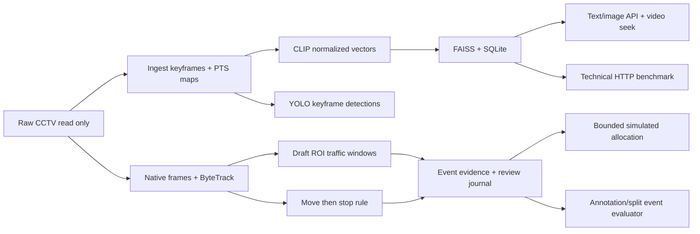

# Báo cáo kỹ thuật đồ án CCTV — VGU Explore Computer Science

Ngày lập: 2026-10-01. Phạm vi: baseline demo trên Windows 11 Native,
PowerShell, RTX 4070 Laptop 8GB. Báo cáo phản ánh M0–M6.2 và công cụ bàn giao
T6.3; chưa nghiệm thu chạy máy thứ hai hoặc chất lượng nhận diện trên nhãn thật.

## 1. Bài toán và kết quả hiện có

Hệ thống truy hồi keyframe CCTV để người dùng tìm và mở video tại thời điểm
tương ứng, quan sát thống kê giao thông, xem ứng viên sự kiện và thử gợi ý
phân bổ nhân lực. Kiến trúc phát triển từ pipeline/index/API kế thừa thay vì
viết lại: giữ keyframe naming, CSV map, SQLite frames và ID FAISS.

Đã chạy được text/image retrieval, video seek, detector xe, tracking clip,
traffic windows, đóng gói evidence và review bằng CLI, rule nghi sự cố,
solver nhân lực mô phỏng, event evaluator và phép đo HTTP latency.
Chưa có multimodal fusion OCR/ASR cho CCTV, event/dispatch UI hoặc hệ thống
nhận diện tai nạn đã kiểm định. Các kết quả này là nền demo có thể kiểm thử.

## 2. Dữ liệu và phạm vi thực nghiệm

Sáu video gốc từ hai camera N001/N002 được người dùng xác nhận; manifest:
`configs/cctv.demo.json`. Raw nằm ngoài repo tại `D:\Project ExploreCS\Demo_Data`,
chỉ đọc. Chưa biết vị trí camera, thời gian tuyệt đối hoặc recording groups.
Không suy các thông tin này từ tên file/overlay. Hai ROI draft vẫn pending.

| Đối tượng | Quy mô đã chạy | Giới hạn diễn giải |
| --- | ---: | --- |
| Ingestion/retrieval | 7.232 keyframe, khoảng 2 FPS | Không dùng chuỗi keyframe này thay tracking native FPS |
| Detection keyframe | 150.204 bounding boxes | Không phải số xe duy nhất hoặc lưu lượng thực |
| Tracking | 6 clip `[30,40)`, 12 segment 5 giây, 1.501 frame | Chỉ 60 giây camera-time; không đại diện toàn bộ footage |
| Track observations/IDs | 31.065 observations, 1.001 scoped IDs | ID có scope run/video/segment, không phải unique vehicles |
| Traffic | 30 window 2 giây, 0 candidate | Ngưỡng chưa hiệu chỉnh; không chứng minh không có tắc đường |
| Rule nghi sự cố | 0 candidate trên sáu clip | Không chứng minh video không có tai nạn |
| Event labels | 6 interval pending; split unassigned | Chưa đủ điều kiện tính quality metrics |

## 3. Kiến trúc và cơ sở thiết kế

CLIP dùng revision cố định, một instance theo stage, FP16/autocast trên CUDA;
vector chuẩn hóa FP32. Với hai vector đơn vị, inner product bằng cosine:
`cos(u,v) = u·v / (||u|| ||v||) = u·v`. FAISS `IndexIDMap2(IndexFlatIP(768))`
tìm chính xác, tránh thêm tham số approximate index khi baseline chỉ 7.232 ảnh.
Cosine score không phải xác suất tai nạn. SQLite mở `mode=ro` khi retrieval.
Text query baseline bằng tiếng Anh; chất lượng tiếng Việt chưa được đánh giá.

Keyframe map giữ PTS tương đối frame giải mã đầu tiên và ordinal 0-based.
ByteTrack chạy trên frame native liên tiếp, reset ID theo segment; tránh suy
motion từ sampling 2 FPS. Count sử dụng điểm tham chiếu box trong ROI; occupancy
union tránh đếm chồng diện tích. Motion tính theo pixel/giây, chưa phải km/h.
Ngưỡng và persistence trong config là baseline chưa calibration.

Move-then-stop dùng lịch sử scoped track và PTS, reset khi gap/ID/ROI/segment
không hợp lệ. Xe chờ đèn đỏ cũng có thể tạo ứng viên. Vì vậy output là
`suspected_road_incident`, cần review, không kết luận tai nạn tự động.

Dispatch chỉ chạy với zone/team/travel mô phỏng. Exact solver trong giới hạn
12 team/12 demand ưu tiên lexicographic theo priority, rồi giảm travel và
staff; giữ whole team, skills, allowed zones, shared budget và reserve.
Event source lấy trạng thái từ review journal, không tin review_status do
request tự khai. Không gửi lệnh điều động hoặc gán vị trí camera thực tế.

## 4. Kiểm thử và đánh giá

Các module dùng contracts có version, output riêng, checksum publication,
checkpoint/resume và kiểm tra input overlap. Kiểm thử gồm schema lỗi,
interruption, corruption, native PTS, locator joins, review CAS/hash chain,
matching và solver oracle. Core suite T6.2: **182 tests đạt**, pip check và
CUDA FP16/NMS đạt; không tuyên bố full legacy suite đã đạt.
Sau bổ sung exporter T6.3, core suite đạt **189 tests**; package evidence
được kiểm tra source binding, corruption, raw protection và no-op resume.

10 quỹ đạo synthetic kiểm thử rule nghi sự cố, gồm trường hợp đèn đỏ tạo
false alarm. Event evaluator kiểm tra temporal IoU 0,1/0,3/0,5, matching exact
max-total-IoU, precision/recall/F1, false alarms/reviewed camera-hour và delay
theo source PTS. Fixture TP=1/FP=2/FN=1 chỉ kiểm tra phép tính; không phải
accuracy trên CCTV. Thực nghiệm thật trả `NOT_EVALUATED_NO_REVIEWED_INTERVALS`,
metrics=null và split_ready=false.

HTTP benchmark T6.2 đóng băng config, index/model/code, ảnh query và session
server. 6 text + 6 image query, top-k=12, 2 warmup và 10 samples/query,
concurrency=1: 24 warmup, 120 request đo, không lỗi.

| Loại query | Samples | P50 (ms) | P95 (ms) | Mean (ms) |
| --- | ---: | ---: | ---: | ---: |
| Text | 60 | 52,66 | 56,43 | 52,94 |
| Image | 60 | 127,91 | 141,34 | 129,30 |

Khoảng đo là client HTTP wall time nhận toàn response, gồm preprocessing,
inference, retrieval và transfer; loại đọc ảnh, JSON validation, warmup và
cold start. P95 là empirical linear quantile; mẫu nhỏ, tải tuần tự và client
khác không bị chặn, nên không khẳng định SLA hoặc khả năng nhiều người dùng.
Ảnh query lấy từ index để kiểm thử API, không cung cấp relevance labels;
Recall@K/MRR vẫn null. Allocator peak toàn phiên model: allocated=843,79 MiB,
reserved=862 MiB; không phải tổng VRAM Windows hoặc peak riêng request.

Mô phỏng phân bổ: roster 6, available 4, reserve 2, dispatchable cap 2.
Solver gán SIM-TEAM-A (2 người) cho demand priority 4; giữ 2 người dự phòng,
2 demands unmet do review gate/shared cap. Event package thật rỗng tạo
0 assignment; synthetic case ở needs_more_evidence cũng bị gate chặn.

## 5. Bằng chứng và tái lập

| Nội dung | Artifact cục bộ / tài liệu kiểm tra |
| --- | --- |
| Manifest/index | `configs/cctv.demo.json`, `outputs/demo-data/search-index/index_state.json` |
| Detection/tracking | `outputs/demo-data-review/detection-verification.json`, `tracking-verification.json` |
| Traffic/incidents | `outputs/demo-data-review/congestion-verification.json`, `incident-verification.json` |
| Allocation | `outputs/demo-data/dispatch-simulation-v1/dispatch_report.json`, `docs/CCTV_DISPATCH.md` |
| Event quality pending | `outputs/demo-data/event-benchmark-pending-v1/benchmark_report.json` |
| HTTP latency | `outputs/demo-data/runtime-benchmark-v1/runtime_report.json` |
| Core tests | `outputs/tests/core-tests.txt`; log này được cập nhật sau mỗi task |

Tài liệu triển khai theo module nằm trong `docs/CCTV_*.md`; tiến độ hiện hành
trong [CCTV_PROGRESS.md](CCTV_PROGRESS.md). Git history ghi Conventional
Commits; commit T6.2 là `c6063a1`. Outputs/media/models không đưa lên Git.
[CCTV_HANDOVER.md](CCTV_HANDOVER.md) cung cấp lệnh PowerShell dựng lại theo
stage và exporter cho package evidence nhỏ, giữ máy thứ hai ở NOT_RUN.

## 6. Công việc tiếp theo

Nghiệm thu trên máy thứ hai với commit, cấu hình và log riêng; duyệt ROI,
xác nhận recording groups để chống leakage; tạo nhãn relevance/event độc lập
và reviewed coverage; hiệu chỉnh ngưỡng trên development rồi đánh giá test.
Sau đó mới so sánh baseline, phân tích lỗi, bổ sung event/dispatch UI và
thử camera/nguồn lực thực. Hiện chỉ nghiệm thu demo kỹ thuật, không nghiệm
thu nhận diện tai nạn hoặc khuyến nghị điều phối hoạt động thực tế.
