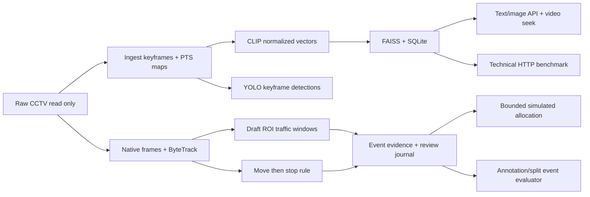

# Báo cáo kỹ thuật đồ án CCTV — VGU Explore Computer Science

Ngày lập: 2026-10-01. Phạm vi: baseline demo trên Windows 11 Native,
PowerShell, RTX 4070 Laptop 8GB. Báo cáo phản ánh M0–T8.1; benchmark latency
T6.2 là phép đo lịch sử. Chưa nghiệm thu chạy máy thứ hai hoặc chất lượng
nhận diện trên nhãn thật.

## 1. Bài toán và kết quả hiện có

Hệ thống truy hồi keyframe CCTV để người dùng tìm và mở video tại thời điểm
tương ứng, quan sát thống kê giao thông, xem ứng viên sự kiện và thử gợi ý
phân bổ nhân lực. Kiến trúc phát triển từ pipeline/index/API kế thừa thay vì
viết lại: giữ keyframe naming, CSV map, SQLite frames và ID FAISS.

Đã chạy được text/image retrieval, video seek, detector xe, tracking clip,
traffic windows, đóng gói evidence và review bằng CLI, rule nghi sự cố,
solver nhân lực mô phỏng, event evaluator và phép đo HTTP latency.
Event/dispatch UI chỉ đọc đã có ở T7.1–T7.2.
Chưa có multimodal fusion OCR/ASR cho CCTV hoặc hệ thống
nhận diện tai nạn đã kiểm định. Các kết quả này là nền demo có thể kiểm thử.

## 2. Dữ liệu và phạm vi thực nghiệm

Sáu video gốc từ hai camera N001/N002 được người dùng xác nhận; manifest:
`configs/cctv.demo.json`. Raw nằm ngoài repo tại `D:\Project ExploreCS\Demo_Data`,
chỉ đọc. Chưa biết vị trí camera, thời gian tuyệt đối hoặc recording groups.
Không suy các thông tin này từ tên file/overlay. Hai ROI draft vẫn pending.

| Đối tượng | Quy mô đã chạy | Giới hạn diễn giải |
| --- | ---: | --- |
| Ingestion/retrieval | 7.232 keyframe, khoảng 2 FPS | Không dùng chuỗi keyframe này thay tracking native FPS |
| Detection keyframe | 150.204 bounding boxes | Không phải số xe duy nhất hoặc lưu lượng thực |
| Tracking | 6 clip `[30,40)`, 12 segment 5 giây, 1.501 frame | Chỉ 60 giây camera-time; không đại diện toàn bộ footage |
| Track observations/IDs | 31.065 observations, 1.001 scoped IDs | ID có scope run/video/segment, không phải unique vehicles |
| Traffic | 30 window 2 giây, 0 candidate | Ngưỡng chưa hiệu chỉnh; không chứng minh không có tắc đường |
| Rule nghi sự cố | 0 candidate trên sáu clip | Không chứng minh video không có tai nạn |
| Event labels | 6 interval pending; split unassigned | Chưa đủ điều kiện tính quality metrics |

## 3. Kiến trúc và cơ sở thiết kế

CLIP dùng revision cố định, một instance theo stage, FP16/autocast trên CUDA;
vector chuẩn hóa FP32. Với hai vector đơn vị, inner product bằng cosine:
`cos(u,v) = u·v / (||u|| ||v||) = u·v`. FAISS `IndexIDMap2(IndexFlatIP(768))`
tìm chính xác, tránh thêm tham số approximate index khi baseline chỉ 7.232 ảnh.
Cosine score không phải xác suất tai nạn. SQLite mở `mode=ro` khi retrieval.
Text query baseline bằng tiếng Anh; chất lượng tiếng Việt chưa được đánh giá.

Keyframe map giữ PTS tương đối frame giải mã đầu tiên và ordinal 0-based.
ByteTrack chạy trên frame native liên tiếp, reset ID theo segment; tránh suy
motion từ sampling 2 FPS. Count sử dụng điểm tham chiếu box trong ROI; occupancy
union tránh đếm chồng diện tích. Motion tính theo pixel/giây, chưa phải km/h.
Ngưỡng và persistence trong config là baseline chưa calibration.

Move-then-stop dùng lịch sử scoped track và PTS, reset khi gap/ID/ROI/segment
không hợp lệ. Xe chờ đèn đỏ cũng có thể tạo ứng viên. Vì vậy output là
`suspected_road_incident`, cần review, không kết luận tai nạn tự động.

Dispatch chỉ chạy với zone/team/travel mô phỏng. Exact solver trong giới hạn
12 team/12 demand ưu tiên lexicographic theo priority, rồi giảm travel và
staff; giữ whole team, skills, allowed zones, shared budget và reserve.
Event source lấy trạng thái từ review journal, không tin review_status do
request tự khai. Không gửi lệnh điều động hoặc gán vị trí camera thực tế.

## 4. Kiểm thử và đánh giá

Các module dùng contracts có version, output riêng, checksum publication,
checkpoint/resume và kiểm tra input overlap. Kiểm thử gồm schema lỗi,
interruption, corruption, native PTS, locator joins, review CAS/hash chain,
matching và solver oracle. Core suite T6.2: **182 tests đạt**, pip check và
CUDA FP16/NMS đạt; không tuyên bố full legacy suite đã đạt.
Sau bổ sung exporter T6.3, core suite đạt **189 tests**; package evidence
được kiểm tra source binding, corruption, raw protection và no-op resume.

10 quỹ đạo synthetic kiểm thử rule nghi sự cố, gồm trường hợp đèn đỏ tạo
false alarm. Event evaluator kiểm tra temporal IoU 0,1/0,3/0,5, matching exact
max-total-IoU, precision/recall/F1, false alarms/reviewed camera-hour và delay
theo source PTS. Fixture TP=1/FP=2/FN=1 chỉ kiểm tra phép tính; không phải
accuracy trên CCTV. Thực nghiệm thật trả `NOT_EVALUATED_NO_REVIEWED_INTERVALS`,
metrics=null và split_ready=false.

HTTP benchmark T6.2 đóng băng config, index/model/code, ảnh query và session
server. 6 text + 6 image query, top-k=12, 2 warmup và 10 samples/query,
concurrency=1: 24 warmup, 120 request đo, không lỗi.

| Loại query | Samples | P50 (ms) | P95 (ms) | Mean (ms) |
| --- | ---: | ---: | ---: | ---: |
| Text | 60 | 52,66 | 56,43 | 52,94 |
| Image | 60 | 127,91 | 141,34 | 129,30 |

Khoảng đo là client HTTP wall time nhận toàn response, gồm preprocessing,
inference, retrieval và transfer; loại đọc ảnh, JSON validation, warmup và
cold start. P95 là empirical linear quantile; mẫu nhỏ, tải tuần tự và client
khác không bị chặn, nên không khẳng định SLA hoặc khả năng nhiều người dùng.
Ảnh query lấy từ index để kiểm thử API, không cung cấp relevance labels;
Recall@K/MRR vẫn null. Allocator peak toàn phiên model: allocated=843,79 MiB,
reserved=862 MiB; không phải tổng VRAM Windows hoặc peak riêng request.

Mô phỏng phân bổ: roster 6, available 4, reserve 2, dispatchable cap 2.
Solver gán SIM-TEAM-A (2 người) cho demand priority 4; giữ 2 người dự phòng,
2 demands unmet do review gate/shared cap. Event package thật rỗng tạo
0 assignment; synthetic case ở needs_more_evidence cũng bị gate chặn.

## 5. Bằng chứng và tái lập

| Nội dung | Artifact cục bộ / tài liệu kiểm tra |
| --- | --- |
| Manifest/index | `configs/cctv.demo.json`, `outputs/demo-data/search-index/index_state.json` |
| Detection/tracking | `outputs/demo-data-review/detection-verification.json`, `tracking-verification.json` |
| Traffic/incidents | `outputs/demo-data-review/congestion-verification.json`, `incident-verification.json` |
| Allocation | `outputs/demo-data/dispatch-simulation-v1/dispatch_report.json`, `docs/CCTV_DISPATCH.md` |
| Event quality pending | `outputs/demo-data/event-benchmark-pending-v1/benchmark_report.json` |
| HTTP latency | `outputs/demo-data/runtime-benchmark-v1/runtime_report.json` |
| Core tests | `outputs/tests/core-tests.txt`; log này được cập nhật sau mỗi task |

Tài liệu triển khai theo module nằm trong `docs/CCTV_*.md`; tiến độ hiện hành
trong [CCTV_PROGRESS.md](CCTV_PROGRESS.md). Git history ghi Conventional
Commits; commit T6.2 là `c6063a1`. Outputs/media/models không đưa lên Git.
[CCTV_HANDOVER.md](CCTV_HANDOVER.md) cung cấp lệnh PowerShell dựng lại theo
stage và exporter cho package evidence nhỏ, giữ máy thứ hai ở NOT_RUN.

## 6. Công việc tiếp theo

Nghiệm thu trên máy thứ hai với commit, cấu hình và log riêng; duyệt ROI,
xác nhận recording groups để chống leakage; tạo nhãn relevance/event độc lập
và reviewed coverage; hiệu chỉnh ngưỡng trên development rồi đánh giá test.
Sau đó mới so sánh baseline, phân tích lỗi, bổ sung event/dispatch UI và
thử camera/nguồn lực thực. Hiện chỉ nghiệm thu demo kỹ thuật, không nghiệm
thu nhận diện tai nạn hoặc khuyến nghị điều phối hoạt động thực tế.

## Cập nhật sau bàn giao: T7.1

Demo đã có tab Sự kiện & evidence chỉ đọc: event v1/v2, review state/revision,
case synthetic riêng và mở native-PTS evidence trong video. Core suite đạt
194 tests. Dispatch UI và việc ghi review qua UI vẫn còn mở; latency trong
mục 4 là phép đo code T6.2, chưa đo lại code API T7.1.
## Bổ sung T7.2 — phân bổ mô phỏng trên UI

T7.2 nối báo cáo T5.2 vào GET API/tab Phân bổ mô phỏng. Màn hình hiển thị
roster, nhân lực sẵn sàng, cap, dự phòng, đội đã xếp và lý do unmet. Adapter
đối chiếu checksum/config/event/journal với inputs hiện tại và kiểm tra khả
thi; request không chạy solver hoặc nạp thêm model. Journal/config đổi sẽ
làm báo cáo cũ chưa khả dụng, cần output mới từ CLI.

Bộ Windows hiện đạt 202 core tests, pip check, compile, CUDA FP16/NMS.
HTTP demo thật có ba gói: simulation 1 assignment/2 unmet, events_empty 0/0,
review_gate 0/1. Simulation xếp 2 người và giữ dự phòng 2; review gate còn
`needs_more_evidence` revision 3, không được phân bổ. 68 artifacts/configs
giữ SHA/mtime sau HTTP; browser kiểm tra ba kịch bản và Home/End, console
không lỗi. Chi tiết: `CCTV_DISPATCH_UI.md` và output verification local.

Đây vẫn là nguồn lực/tình huống mô phỏng. Không ghi review hoặc phát lệnh điều
động; chưa nghiệm thu chất lượng phát hiện sự kiện hoặc phân bổ thực tế.
T7.3 kiểm thử demo đầu-cuối và đo lại runtime của code mới; phép đo
T6.2 vẫn chỉ đại diện phiên bản code tại thời điểm đo.

## Bổ sung T7.3 — nghiệm thu kỹ thuật demo cục bộ

CLI nghiệm thu HTTP đã có, đọc metadata SQLite độc lập và kiểm tra UI assets,
text/image, ảnh/video Range, traffic, event và review-bound dispatch.
Report cuối `outputs/demo-data/acceptance-t7-v2/acceptance_report.json` kiểm
tra raw/config/index/code/assets giữ SHA/mtime. Browser xác minh tìm kiếm
trả 12 kết quả và mở video tại 488,014 giây, traffic 30,037 giây, event
35,996 giây; video readyState=4, review gate 0 assignment/1 unmet, console
không lỗi. Đây là checks chạy thử, không phải nhãn chất lượng.

Benchmark mới `runtime-benchmark-t7-v1`: 24 warmup và 120 request đo, lỗi=0.
Text P50/P95 49,76/53,78 ms; image 147,91/167,64 ms. Model-lifetime allocated
peak 851,91 MiB, reserved 862 MiB. Cùng workload/model/index với T6.2 nhưng
khác phiên đo; không kết luận tác động nhân quả của UI lên hiệu năng.
Resume hoàn chỉnh giữ hai report/checkpoint SHA/mtime. Bộ Windows đạt 208
core tests, pip check/compile/CUDA FP16/NMS đạt.

M7 đã đạt nghiệm thu kỹ thuật cục bộ; chất lượng retrieval/event, ROI và
calibration, vị trí/nguồn lực thật, chạy trên máy thứ hai vẫn chưa nghiệm thu.
Quy trình/lệnh đầy đủ: `CCTV_DEMO_ACCEPTANCE.md`.

## Bổ sung T8.1 — chuẩn bị tư liệu review, chưa tạo ground truth

Bundle pending đã có 36 JPEG sạch nguyên bản từ sáu khoảng `[30,40)`, sáu
contact sheets với locator nguồn và sáu ROI overlays ở trang riêng.
Không đọc predictions/journal để tạo ảnh; labeling page không có ROI hints,
video sử dụng preview nguồn và offset PTS hiện có. Forms vẫn 0 reviewed/
approved; groups unverified, splits unassigned. Không sửa config gốc.

Windows core suite đạt 214 tests, pip check/compile/CUDA FP16/NMS đạt.
Resume skip sáu interval, 55 bundle artifacts giữ SHA/mtime; 59 inputs được
freeze. Browser tải đủ sheets, seek N001-V001 30,000 giây, readyState=4,
console không lỗi; raw/upstream không đổi. Chi tiết:
`CCTV_REVIEW_PREPARATION.md` và verification local dưới outputs.

Các khoảng demo đã dùng chạy thử pipeline, không phải mẫu đại diện hoặc
blind test mới. Ảnh sạch không chứng minh reviewer độc lập. Review/nhãn thật
và recording groups phải do con người xác minh; chưa tính metrics thật.

## Bổ sung T8.2 — notes riêng và validation trước adjudication

Module `pipeline.cctv.review_notes` tạo hai slot pending, kiểm tra schema,
manifest/template SHA, scope/PTS, tên reviewer khác nhau và timestamp có
timezone. Unknown không thành âm tính; complete phải khai báo đã xem toàn
khoảng/ontology. So sánh exact label/start/end multisets, không phụ thuộc
ID ghi chú, không auto-merge hoặc xuất annotation reviewed.

Demo tạo hai templates và báo cáo sáu khoảng pending; reviewer null,
ground_truth_published=false, reviewed_intervals=0. 11 tests mới dùng fixtures
giả xác minh agreement/disagreement, unknown/exposure, provenance/identity,
bounds và bảo toàn output/resume. Ghi chú thật và adjudication chưa có;
blind review chỉ là khai báo, không được xác thực. Hướng dẫn Windows:
`CCTV_REVIEW_NOTES.md`. Windows core suite đạt 225 tests; pip check,
compile và CUDA FP16/NMS đạt. Bước kỹ thuật kế tiếp T8.3 là adjudication/export.

## Bổ sung T8.3 — explicit adjudication và annotation export

Module `pipeline.cctv.adjudication` tạo template quyết định pending và xuất
schema annotation T6.1 từ quyết định tường minh. Notes/template/manifest
SHA, scope, hai reviewer khác nhau, complete/blind, final acceptance và
decision timestamp được kiểm tra trước xuất reviewed. Adjudicator và
provenance/reason được giữ ở report riêng. Đồng thuận không tự duyệt;
pending/unknown không thành negative labels. Khai báo con người chưa được
xác thực; công cụ không chứng minh blind review hoặc chất lượng nhãn.

Demo local có sáu khoảng pending, 0 reviewed, independent_ground_truth_exported
false. Evaluator đọc export mới và trả NOT_EVALUATED_NO_REVIEWED_INTERVALS,
metrics null, split vẫn chưa sẵn sàng. 69 files giữ SHA/mtime sau resume;
sáu raw videos và upstream artifacts không đổi. Windows core suite đạt 235
tests, pip check/compile/CUDA FP16/NMS đạt; 10 tests adjudication dùng fixtures
synthetic. Quy trình/lệnh đầy đủ: `CCTV_ADJUDICATION.md`.

T8.1–T8.3 đã có công cụ; review/adjudication thật, xác nhận groups/splits,
duyệt ROI và chạy trên máy thứ hai vẫn là điều kiện nghiệm thu còn mở.

## Bổ sung T9.1 — tiện ích chạy thử demo HTTP

`Test-CctvDemo.ps1` quản lý start/ready/check/stop trong một lệnh, một process
với một server thread/worker và một CLIP instance. Socket reservation diễn ra
trước inference; existing mode không khởi động hoặc dừng server khác. Client
T7.3 giữ nguyên checks và provenance/raw SHA guards. Không thay baseline
models/pipeline hoặc tự duyệt dữ liệu pending.

Managed run CUDA/FP16 trên 8087 đạt HTTP checks, 100 protected files giữ
SHA/mtime, server shutdown thành công. Đây là kiểm tra HTTP tích hợp,
không thêm bằng chứng browser playback, nhãn chất lượng hoặc máy thứ hai.
Hướng dẫn/code/lệnh: `CCTV_DEMO_SMOKE.md`.

Windows core suite đạt 244 tests, pip check/compile/CUDA FP16/NMS đạt.
Socket 8087 bind được lại sau managed run, xác minh server đã giải phóng cổng.

## Bổ sung T9.2 — tracking overlay offline trên CPU

Module `pipeline.cctv.tracking_overlay` vẽ bbox/segment-scoped IDs từ ledger
và xuất MP4 H.264 trên CPU, không chạy lại model. Source SHA, frame_idx,
native PTS/timebase/origin, camera/video/run và kích thước được đối chiếu
khi ghép raw với tracking. MP4 được decode lại để kiểm tra từng PTS; offset
playback/source giữ timestamp frame đầu thực tế, không dùng start yêu cầu
thay timestamp nguồn. Banner ghi predictions và ROI pending.

Windows core suite đạt 252 tests, pip check/compile/CUDA FP16/NMS đạt.
8 tests mới dùng synthetic tracking kiểm tra H.264/PTS, invalid/missing
frames, scope/source guards, edited output và resume. Đây là baseline
visualization, chưa đo chất lượng tracking/incident. Quy trình/code/lệnh:
`CCTV_TRACKING_OVERLAY.md`. Nối overlay vào traffic UI là task T9.3 riêng.

Demo v2 đã xuất sáu MP4/1.501 frames với PTS verify; resume skip cả sáu
không decode lại, 26 files giữ SHA/mtime. Sáu raw videos và tracking/upstream
packages không đổi. QA frame từ MP4 hiển thị bbox/ID và scope/PTS/pending.

## Bổ sung T9.3 — overlay API/UI chỉ đọc

Traffic tab có nút xem bbox/ID tracking tại cửa sổ nguồn. Optional store
kiểm tra allowlist/manifest/tracking/raw/source association, count/PTS offset
và MP4 checksum; ordinary edits invalidate overlay. Missing overlay không
tắt retrieval hoặc traffic. Raw-preview locator giữ nguyên; overlay sử
dụng offset source frame đầu, không suy timestamp từ FPS. Không duyệt ROI,
event labels hoặc gán nguồn lực thật.

Windows core suite đạt 259 tests, pip check/compile/CUDA FP16/NMS đạt.
RequireOverlays smoke trên 8087 đạt sáu clips/30 windows, 108 protected files
giữ SHA/mtime. Browser mở N001-V001 source 36,036 → overlay 5,999 giây,
readyState=4, không console warn/error/media error. Kết quả là technical
playback, không là đánh giá chất lượng tracking. Latency cũ là historical
reports gắn code cũ; không chấm như benchmark của app composition mới.
Code/lệnh và giới hạn: `CCTV_OVERLAY_UI.md`.

## Bổ sung T9.4 — runtime và gói bàn giao sau overlay

Phép đo mới app `9ff3006` ngày 2026-10-01 dùng một CUDA/FP16 server,
top-12, 24 warmup và 120 measured requests, không lỗi. Text P50/P95/mean
=52,18/56,18/52,24 ms; image=128,07/139,86/129,28 ms. Model-lifetime
allocator peak allocated=843,79 MiB, reserved=862 MiB. Đây là latency
HTTP cục bộ, chưa đo relevance/nhận diện sự kiện hoặc kết luận regression.

Report mới `runtime-benchmark-t9-v1` gắn code/index/model/session; giữ
report lịch sử. Resume không HTTP, hai runtime JSON giữ SHA/mtime;
56 protected files gồm raw và artifacts kiểm tra không đổi. Gói mới
`handover-t9-v1` export/resume ba JSON đạt, second-machine NOT_RUN và
event metrics null. T9.4 chỉ cập nhật bằng chứng/tài liệu, không đổi code;
core suite 259 tests đạt tại T9.3. Quy trình: `CCTV_RUNTIME_BENCHMARK.md`
và `CCTV_HANDOVER.md`.
