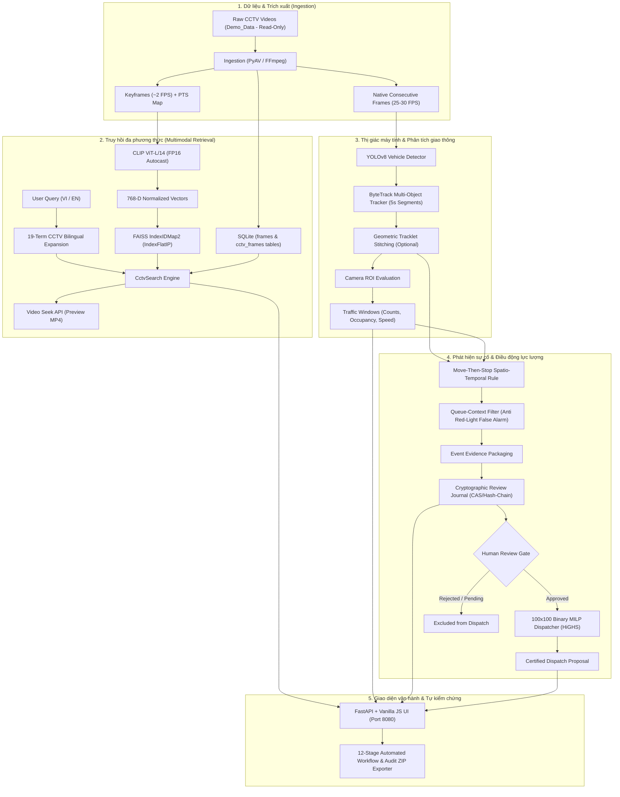

# Báo Cáo Kỹ Thuật Dự Án Hệ Thống Giám Sát CCTV Thông Minh
**Tài liệu kỹ thuật nội bộ dành cho đội ngũ phát triển (Team Technical Handover)**  
*Dự án: CCTV Keyframe Retrieval, Traffic Analysis, Incident Detection & Police Dispatch Proposal*  
*Môi trường chuẩn: Windows 11 Native / WSL2 Ubuntu, Python 3.11, CUDA 12.6, RTX 4070 Laptop 8GB*  
*Cập nhật: Tháng 10/2026*

---

## 1. Tổng Quan Dự Án & Mục Tiêu Kỹ Thuật

### 1.1 Bài toán nghiệp vụ
Hệ thống được thiết kế để giải quyết bài toán giám sát giao thông đô thị tự động hóa dựa trên luồng dữ liệu camera giám sát (CCTV). Thay vì phụ thuộc vào việc trực ban rà soát thủ công hàng nghìn giờ video, hệ thống cung cấp một luồng xử lý khép kín:
1. **Truy hồi đa phương thức (Multimodal Retrieval):** Cho phép người vận hành tìm kiếm khoảnh khắc giao thông bằng câu truy vấn văn bản tự nhiên (tiếng Việt/tiếng Anh) hoặc bằng hình ảnh mẫu, sau đó lập tức mở và phát video chính xác tại giây xuất hiện sự kiện.
2. **Phân tích giao thông thời gian thực (Traffic Analytics):** Tự động phát hiện phương tiện (xe máy, ô tô, xe tải, xe buýt), theo dõi quỹ đạo (tracking), tính mật độ chiếm dụng (occupancy union) và vận tốc di chuyển trong từng vùng quan tâm (ROI).
3. **Phát hiện nghi vấn sự cố (Incident Detection):** Áp dụng luật thời gian-không gian (spatio-temporal rules) để phát hiện hiện tượng dừng bất thường trên làn đường lưu thông, kết hợp bộ lọc bối cảnh hàng xe (queue-context filter) để tránh cảnh báo giả khi phương tiện dừng chờ đèn đỏ.
4. **Gợi ý điều động lực lượng tuần tra (Police Dispatch Optimization):** Giải bài toán tối ưu hóa quy hoạch tuyến tính nguyên hỗn hợp (Binary MILP) để phân bổ các tổ tuần tra phù hợp (kỹ năng, phạm vi phụ trách, thời gian tiếp cận) đến các điểm xảy ra sự cố cần can thiệp.
5. **Giao diện vận hành hợp nhất (Unified Web UI):** Cung cấp giao diện trực quan 5 phân hệ (Search, Traffic, Events, Dispatch, Dataset/Pipeline) với cơ chế tự kiểm chứng (smoke self-test) và xuất báo cáo kiểm định đóng gói (audit ZIP).

### 1.2 Bối cảnh phát triển & Nguồn gốc kiến trúc
Dự án được kế thừa và mở rộng từ kiến trúc tìm kiếm video đa phương thức quy mô lớn (cuộc thi AI Challenge), sau đó được tái cấu trúc thành hệ thống chuyên biệt cho CCTV:
* **Kế thừa an toàn:** Giữ nguyên quy ước đặt tên keyframe, bản đồ ánh xạ PTS (Presentation Time Stamp), cơ sở dữ liệu SQLite lưu trữ metadata frame, và cấu trúc FAISS index.
* **Mở rộng chuyên sâu CCTV:** Bổ sung YOLOv8 detector, ByteTrack multi-object tracking trên frame gốc, mô-đun nối tracklets hình học (geometric track stitching), công thức homography tính vận tốc thực địa, bộ giải HiGHS MILP cho điều động, và kiến trúc tiến trình độc lập phục vụ suy luận CLIP trên Windows.

---

## 2. Kiến Trúc Hệ Thống & Luồng Dữ Liệu (End-to-End Pipeline)

Hệ thống vận hành theo quy trình tuần tự 12 công đoạn (stages) có lưu vết (checkpointed), đảm bảo tính toàn vẹn và khả năng chạy tiếp (resumable) khi gặp sự cố.



---

## 3. Chi Tiết Các Phân Hệ Kỹ Thuật Chính

### 3.1 Phân hệ trích xuất & Đồng bộ hóa thời gian (Ingestion & PTS Alignment)
* **Thư mục mã nguồn:** `pipeline/cctv/ingest.py`, `pipeline/cctv/manifest.py`, `pipeline/cctv/preview.py`.
* **Cơ chế hoạt động:**
  * Giải mã video trực tiếp qua PyAV/FFmpeg để đọc đúng Presentation Time Stamp (PTS) và ordinal index của từng frame.
  * Keyframe được lấy mẫu tại tần suất cơ sở xấp xỉ ~2 FPS (mỗi 0.5 giây), lưu dưới dạng JPEG chất lượng cao trong thư mục output của dataset.
  * Sinh ra file preview MP4 chuẩn H.264 (AAC/h264) thân thiện với trình duyệt web, đảm bảo trình phát HTML5 video seek mượt mà đến từng timestamp.
* **Bảo vệ dữ liệu:** Dữ liệu video gốc trong `Demo_Data/` được gán quyền **chỉ đọc (read-only)** tuyệt đối. Mọi output sinh ra được cô lập trong thư mục `outputs/`.

### 3.2 Phân hệ tìm kiếm đa phương thức (CLIP + FAISS + Bilingual Expansion)
* **Thư mục mã nguồn:** `pipeline/cctv/clip.py`, `pipeline/cctv/clip_process.py`, `pipeline/cctv/index.py`, `pipeline/cctv/search.py`, `app/query_hints.py`.
* **Cơ chế hoạt động:**
  * **Model:** OpenAI CLIP (`ViT-L/14`, chiều embedding $D=768$). Khi chạy trên CUDA, model dùng FP16 autocast để tối ưu VRAM.
  * **Index cấu trúc:** Sử dụng `faiss.IndexIDMap2(faiss.IndexFlatIP(768))`. Với các vector đã chuẩn hóa $L_2$ ($\|u\|_2 = 1$), tích vô hướng (Inner Product) chính là độ tương đồng Cosine:
    $$\text{Cosine}(u, v) = u \cdot v$$
    Hệ thống sử dụng tìm kiếm chính xác (Exact Flat IP), không dùng thuật toán xấp xỉ (IVF/HNSW) vì quy mô keyframe demo (~7.200 ảnh) hoàn toàn vừa khít bộ nhớ RAM và đạt độ trễ cực thấp (<60ms P50).
  * **Mở rộng truy vấn song ngữ (Bilingual Expansion):** Chuyển đổi 19 cụm từ giao thông thông dụng tiếng Việt sang tiếng Anh đặc tả ngữ cảnh CCTV (ví dụ: *"tai nạn giao thông"* $\rightarrow$ *"traffic accident collision on road"*, *"ùn tắc"* $\rightarrow$ *"heavy traffic congestion slow moving"*). Truy vấn tiếng Anh sau chuẩn hóa được đưa vào text encoder.
  * **Kiến trúc quản lý tiến trình (Process Isolation):** Để tránh lỗi sụp đổ bộ nhớ nguyên thủy của Windows (`Windows1455 commit exhaustion / access violation 3221225477`), encoder CLIP phục vụ API được cô lập trong tiến trình riêng (`ProcessClipEncoder`). Tiến trình này tự động giải phóng tài nguyên trước khi hệ thống khởi chạy các công đoạn GPU nặng (như YOLO/ByteTrack) và nạp lại khi hoàn tất.

### 3.3 Phân hệ phát hiện & Bám vết phương tiện (YOLOv8 + ByteTrack + Stitching)
* **Thư mục mã nguồn:** `pipeline/cctv/detect.py`, `pipeline/cctv/track.py`, `pipeline/cctv/stitch.py`, `pipeline/cctv/tracking_overlay.py`.
* **Cơ chế hoạt động:**
  * **Object Detection:** Sử dụng YOLOv8 (tối ưu hóa batch từ 4 $\rightarrow$ 2 $\rightarrow$ 1 nếu phát hiện áp lực VRAM) nhận diện các lớp phương tiện giao thông (car, motorcycle, bus, truck).
  * **Multi-Object Tracking:** Thuật toán ByteTrack bám vết phương tiện trên chuỗi frame native liên tiếp theo từng đoạn ngắn (segment 5 giây). Việc phân đoạn (segmentation) giúp hạn chế rò rỉ bộ nhớ và cho phép lưu checkpoint tiếp tục bám vết nếu bị gián đoạn.
  * **Nối vết hình học (Geometric Tracklet Stitching):** Nối các mẩu tracklet bị ngắt quãng giữa các segment dựa trên:
    * Khoảng cách không gian (Spatial proximity).
    * Vector vận tốc và hướng di chuyển (Velocity & Heading alignment).
    * Độ tương đồng về kích thước bounding box và cùng phân loại phương tiện.
    * *Lưu ý kỹ thuật:* Thuật toán nối vết dựa trên hình học thuần túy, không ghi đè sổ cái gốc (scoped ledger) và không tự nhận là mô hình Visual Re-ID chuyên sâu.

### 3.4 Phân hệ thống kê giao thông & Vùng quan tâm (ROI & Traffic Analytics)
* **Thư mục mã nguồn:** `pipeline/cctv/traffic.py`, `pipeline/cctv/congestion.py`, `configs/cctv.congestion.demo.json`.
* **Cơ chế hoạt động:**
  * **Vùng quan tâm (ROI):** Mỗi camera được định nghĩa một hoặc nhiều đa giác chuẩn hóa (normalized polygon coordinates).
  * **Đếm xe & Mật độ (Count & Occupancy Union):** Phương tiện được tính là nằm trong ROI khi điểm tham chiếu (tâm đáy bounding box) thuộc đa giác ROI. Để tính tỷ lệ chiếm dụng lòng đường (occupancy), hệ thống tính diện tích hợp (union of polygons) của các hộp bounding box cắt với ROI, triệt tiêu hoàn toàn sai số đếm đè diện tích khi các xe nằm sát nhau.
  * **Vận tốc (Speed Estimation):** 
    * Mặc định đo đạc bằng đơn vị **pixel/giây (px/s)**.
    * Chỉ chuyển đổi sang **km/h** khi người dùng cung cấp ma trận đồng biến phẳng (Ground-plane Homography Calibration) từ các mốc khảo sát thực địa đã đo đạc. Nếu chưa có khảo sát, hệ thống ghi nhận `median_speed_kmh: null`, kiên quyết không tự ý nhân tỉ lệ giả định.
  * **Đánh giá ùn tắc (Congestion Rules):** Xác định trạng thái ùn tắc khi mật độ xe vượt ngưỡng đồng thời vận tốc trung bình giảm dưới ngưỡng duy trì liên tục trong cửa sổ thời gian (ví dụ: $\ge 6$ giây).

### 3.5 Phân hệ phát hiện sự cố & Sổ nhật ký thẩm định (Incidents & Review Journal)
* **Thư mục mã nguồn:** `pipeline/cctv/incidents.py`, `pipeline/cctv/events.py`, `pipeline/cctv/review_notes.py`, `pipeline/cctv/adjudication.py`.
* **Cơ chế hoạt động:**
  * **Quy tắc Di-chuyển-rồi-dừng (Move-then-stop rule):** Phát hiện các phương tiện đang di chuyển ở vận tốc bình thường bỗng nhiên dừng hẳn lại bên trong lòng đường (vùng ROI) vượt quá thời gian cho phép.
  * **Bộ lọc bối cảnh hàng xe (Queue-Context Filter):** Đây là cải tiến quan trọng nhằm loại bỏ cảnh báo giả tại các nút giao có đèn tín hiệu. Khi một phương tiện dừng lại nhưng xung quanh nó cũng có nhiều phương tiện khác đồng thời giảm tốc độ và tạo thành hàng xe (collective stopping), hệ thống sẽ hạ mức nghi vấn và theo dõi tiếp. Nếu cả hàng xe cùng di chuyển tiếp khi đèn xanh, ứng viên sự cố bị loại bỏ.
  * **Sổ thẩm định bằng chứng (Review Journal):** Bất kỳ trường hợp nghi sự cố nào (`suspected_road_incident`) đều được đóng gói kèm đoạn clip bằng chứng và ghi vào sổ nhật ký có gắn chuỗi mã băm bảo mật (hash-chaining). Chỉ sau khi kiểm định viên (human reviewer) phê duyệt trạng thái `confirmed`, sự cố mới được đưa sang phân hệ điều động.

### 3.6 Phân hệ tối ưu hóa phân bổ lực lượng (Binary MILP Police Dispatch)
* **Thư mục mã nguồn:** `pipeline/cctv/dispatch.py`, `app/cctv_dispatch.py`, `configs/cctv.resources.simulation.json`.
* **Cơ chế toán học:**
  * Bài toán được mô hình hóa dưới dạng quy hoạch tuyến tính nguyên nhị phân thưa (Sparse Binary Mixed-Integer Linear Programming), giải quyết bài toán phân bổ quy mô lên tới **100 tổ tuần tra $\times$ 100 điểm sự cố**.
  * **Bộ giải:** Sử dụng solver **HiGHS** thông qua `scipy.optimize.milp`.
  * **Hàm mục tiêu từ điển (Lexicographic Multi-Objective):**
    1. Ưu tiên 1 (Tối thượng): Cứu nạn và xử lý các sự cố có mức ưu tiên cao nhất ($\max \sum \text{Priority} \times X_{i,j}$).
    2. Ưu tiên 2: Tối thiểu hóa tổng thời gian di chuyển ($\min \sum \text{TravelTime}_{i,j} \times X_{i,j}$).
    3. Ưu tiên 3: Tối thiểu hóa số lượng nhân lực huy động.
    4. Ưu tiên 4: Phá vỡ thế cân bằng mang tính tất định (Deterministic tie-breaking).
  * **Ràng buộc cứng:** Toàn vẹn tổ tuần tra (không xé lẻ nhân sự), đúng kỹ năng yêu cầu (skills matching), nằm trong khu vực được phép hoạt động (allowed zones), không vượt quá trần điều động (dispatchable cap), và luôn giữ lại lực lượng dự phòng tối thiểu (reserve teams).
  * **Chứng chỉ tối ưu số học (Numerical Optimality Certificate):** Hệ thống kiểm tra khoảng cách nghiệm HiGHS đạt zero-gap và xác minh lại bằng số học nguyên chính xác (giới hạn bảo thủ $2^{40}$). Nếu hệ số không đảm bảo tính toán an toàn, hệ thống sẽ thực hiện cơ chế *Fail Closed* (từ chối phân bổ) thay vì đưa ra quyết định sai lệch.

### 3.7 Phân hệ đám mây lai (Colab GPU Execution & Windows Integration)
* **Thư mục mã nguồn:** `notebooks/CCTV_Colab.ipynb`, `docs/CCTV_FULLVIDEO_COLAB.md`, `app/cctv_workflow.py`.
* **Cơ chế hoạt động:**
  * Đối với các video dài cần bám vết toàn bộ thời lượng (full-video tracking) đòi hỏi GPU mạnh, người dùng có thể xuất gói công việc (**Export Colab Job**) từ Web UI thành file ZIP.
  * Đưa file vào Google Drive và chạy notebook `CCTV_Colab.ipynb` trên GPU T4/A100 miễn phí.
  * Tải kết quả (Result ZIP) về máy cá nhân và nhấn **Import Colab Result**. Hệ thống sẽ tự động xác minh chữ ký toàn vẹn, chuyển đổi đường dẫn hệ điều hành (Linux $\leftrightarrow$ Windows), kiểm tra lại tính hợp lệ của index/tracking và tích hợp vào giao diện cục bộ.

---

## 4. Giao Diện Người Dùng & Các Phân Hệ Vận Hành (Web UI Walkthrough)

Giao diện vận hành đơn trang (SPA) được phát triển bằng Vanilla JavaScript/CSS thuần (nằm tại `static/cctv/`), không đòi hỏi Node.js build step phức tạp. Khi khởi động máy chủ tại cổng `8080`, người dùng có thể thao tác qua 5 tab chức năng:

| Tab | Tên phân hệ | Chức năng nghiệp vụ chính |
| :--- | :--- | :--- |
| **Tab 1** | **Tìm kiếm (Search & Seek)** | Nhập từ khóa (hỗ trợ tiếng Việt tự nhiên) hoặc tải ảnh mẫu. Hiển thị danh sách kết quả trực quan kèm điểm số tương đồng Cosine. Bấm vào bất kỳ kết quả nào sẽ mở ngay trình phát video và tua đến đúng giây xuất hiện hình ảnh đó. |
| **Tab 2** | **Giao thông (Traffic & ROI)** | Chọn camera/video để hiển thị vùng đa giác ROI, đồ thị biến thiên lưu lượng xe, tỷ lệ chiếm dụng lòng đường và timeline vận tốc theo từng cửa sổ 2 giây. |
| **Tab 3** | **Sự kiện & Thẩm định (Events & Review)** | Danh sách các tình huống nghi vấn sự cố và ùn tắc. Cho phép người vận hành xem video clip bằng chứng, đối chiếu thời gian, xác nhận trạng thái thẩm định (`confirmed`, `dismissed`, `needs_more_evidence`). |
| **Tab 4** | **Phân bổ nhân lực (Dispatch Proposal)** | Hiển thị ma trận phân bổ các tổ tuần tra đến hiện trường các sự cố đã được duyệt. Cung cấp thông tin chi tiết về lộ trình di chuyển, kỹ năng đáp ứng và lý do nếu có sự cố chưa thể bố trí nhân sự (unmet reasons). |
| **Tab 5** | **Dữ liệu & Quy trình (Dataset & Workflow)** | Cho phép chọn video có sẵn hoặc tải video mới lên, cấu hình ROI tương tác bằng chuột, khởi chạy toàn bộ 12 công đoạn pipeline, theo dõi tiến độ thời gian thực (progress bar), tự kiểm tra smoke test và tải gói kiểm toán nén (`report.zip`). |

---

## 5. Cấu Trúc Mã Nguồn (Repository Layout)

```
Project ExploreCS/ (hoặc CCTV_keyframes_retrieving/)
├── app/                            # Backend FastAPI & Web APIs
│   ├── cctv.py                     # Entry point chính tạo FastAPI app & quản lý Runtime
│   ├── cctv_workflow.py            # Quản lý 12 công đoạn xử lý batch và Colab import/export
│   ├── cctv_traffic.py             # API phục vụ truy vấn số liệu traffic & ROI
│   ├── cctv_events.py              # API quản lý danh sách sự kiện & clip bằng chứng
│   ├── cctv_dispatch.py            # API quản lý ma trận phân bổ tuần tra
│   ├── cctv_overlay.py             # API phục vụ video gắn bounding box/ID tracking
│   └── query_hints.py              # Từ điển mở rộng truy vấn song ngữ Việt - Anh
│
├── pipeline/cctv/                  # Toàn bộ lõi thuật toán xử lý dữ liệu CCTV
│   ├── ingest.py                   # Trích xuất keyframe và lập bảng ánh xạ PTS
│   ├── index.py                    # Trích xuất đặc trưng CLIP và xây dựng FAISS index
│   ├── search.py                   # Động cơ tìm kiếm tương đồng vector Cosine
│   ├── detect.py                   # Nhận diện phương tiện giao thông (YOLOv8)
│   ├── track.py                    # Bám vết phương tiện đa đối tượng (ByteTrack)
│   ├── stitch.py                   # Thuật toán nối mẩu vết hình học liên segment
│   ├── congestion.py               # Phân tích lưu lượng, mật độ occupancy và ùn tắc
│   ├── incidents.py                # Luật phát hiện phương tiện dừng bất thường & lọc hàng xe
│   ├── dispatch.py                 # Bộ giải tối ưu hóa phân bổ lực lượng HiGHS MILP
│   ├── preview.py                  # Tạo video nén MP4 phục vụ phát mượt mà trên web
│   └── tracking_overlay.py         # Vẽ bounding box và track ID lên video phục vụ kiểm chứng
│
├── configs/                        # Cấu hình JSON cho hệ thống
│   ├── cctv.demo.json              # Khai báo danh mục camera và file video mẫu
│   ├── cctv.bytetrack.yaml         # Siêu tham số cho ByteTrack tracker
│   ├── cctv.congestion.demo.json   # Ngưỡng phát hiện ùn tắc giao thông
│   ├── cctv.incidents.demo.json    # Ngưỡng phát hiện nghi vấn tai nạn / xe dừng
│   └── cctv.resources.simulation.json # Cấu hình danh sách tổ tuần tra mô phỏng
│
├── static/cctv/                    # Giao diện Web Front-end (HTML / CSS / JS)
│   ├── index.html                  # Khung giao diện chính tích hợp 5 tab
│   ├── app.js                      # Điều phối tìm kiếm đa phương thức & phát video
│   ├── traffic.js                  # Vẽ đồ thị giao thông & hiển thị ROI
│   ├── events.js                   # Xử lý bằng chứng sự kiện & thẩm định
│   ├── dispatch.js                 # Hiển thị bảng phân bổ lực lượng
│   └── workflow.js                 # Điều khiển quy trình chạy pipeline và xuất/nhập Colab
│
├── scripts/                        # Các kịch bản thực thi PowerShell & Python tiện ích
│   ├── Start-CctvDemo.ps1          # Lệnh chuẩn khởi động ứng dụng demo trên Windows
│   ├── Open-CctvDemo.cmd           # File nhấp đúp chạy nhanh cho người dùng cuối
│   ├── Setup-Windows.ps1           # Kịch bản cài đặt môi trường và tải thư viện tự động
│   ├── Test-CctvDemo.ps1           # Chạy toàn bộ bộ kiểm thử tự động (Core test suite)
│   └── Test-SecondMachineHandover.ps1 # Kiểm tra bàn giao và tính tương thích trên máy mới
│
├── docs/                           # Tài liệu kỹ thuật chi tiết theo từng phân hệ
│   ├── TEAM_TECHNICAL_REPORT.md    # Báo cáo kỹ thuật tổng hợp cho đội ngũ (file này)
│   ├── CCTV_PROJECT_REPORT.md      # Báo cáo kỹ thuật chi tiết gốc của dự án
│   ├── CCTV_PROGRESS.md            # Bảng nhật ký tiến độ và các mốc hoàn thành
│   ├── CCTV_UI_WORKFLOW.md         # Hướng dẫn chi tiết sử dụng giao diện workflow
│   ├── CCTV_FULLVIDEO_COLAB.md     # Hướng dẫn chi tiết chạy batch trên Google Colab
│   └── WINDOWS_SETUP.md            # Hướng dẫn cấu hình môi trường Windows Native
│
└── notebooks/
    └── CCTV_Colab.ipynb            # Jupyter Notebook chạy trên Google Colab GPU
```

---

## 6. Hướng Dẫn Vận Hành & Phát Triển Dành Cho Thành Viên Đội Ngũ

### 6.1 Khởi động nhanh ứng dụng (Quick Start)
Để khởi động hệ thống demo trực tiếp trên máy Windows:
1. Mở PowerShell trong thư mục gốc của dự án:
   ```powershell
   Set-Location "D:\Project ExploreCS\CCTV_keyframes_retrieving"
   ```
2. Khởi động server demo:
   ```powershell
   .\scripts\Start-CctvDemo.ps1 -Port 8080 -Device cuda
   ```
   *(Hoặc nhấp đúp chuột vào file `Open-CctvDemo.cmd`)*
3. Mở trình duyệt web truy cập địa chỉ: `http://127.0.0.1:8080`.

### 6.2 Chạy bộ kiểm thử tự động (Running Tests)
Trước khi đóng góp (commit) bất kỳ thay đổi nào về thuật toán hay API, bắt buộc phải chạy bộ kiểm thử để đảm bảo tính hồi quy:
```powershell
# Chạy toàn bộ core tests trên Windows
.\scripts\Test-CctvDemo.ps1

# Hoặc chạy kiểm thử một phân hệ cụ thể thông qua pytest:
.venv\Scripts\pytest -q test_cctv_api.py
.venv\Scripts\pytest -q test_cctv_dispatch.py
.venv\Scripts\pytest -q test_cctv_incidents.py
.venv\Scripts\pytest -q test_cctv_traffic.py
```

---

## 7. Các Nguyên Tắc Thiết Kế Kỹ Thuật Bắt Buộc (Engineering Standards)

Khi tiếp tục mở rộng và phát triển dự án, các thành viên cần tuân thủ nghiêm ngặt 5 nguyên tắc sau:

1. **Bất biến đối với dữ liệu thô (Data Immutability):**
   Thư mục `Demo_Data/` và các video raw của khách hàng là dữ liệu chỉ đọc. Tuyệt đối không được ghi đè, xóa, đổi tên hay chỉnh sửa metadata của các file gốc. Mọi kết quả xử lý phải ghi vào thư mục `outputs/`.
2. **Trung thực về mặt khoa học (Scientific Gating & No Fake Metrics):**
   * Nếu chưa có khảo sát thực địa đo đạc điểm mốc (surveyed markers) để tính toán ma trận đồng biến phẳng (homography), trường vận tốc `median_speed_kmh` bắt buộc phải giữ giá trị `null` (chỉ hiển thị đơn vị `pixel/s`). Không bao giờ nhân một hệ số ước lượng tùy tiện để sinh ra km/h giả.
   * Số lượng ứng viên sự cố bằng 0 (`0 candidates`) trên 6 clip mẫu chỉ phản ánh kết quả chạy của rule trên tập dữ liệu đó, **không đồng nghĩa** với việc khẳng định video tuyệt đối không có tai nạn.
3. **Cổng kiểm duyệt người thật (Human-in-the-loop Gate):**
   Phân hệ phân bổ cảnh sát (Dispatch) tuyệt đối không tự động lấy dữ liệu từ các phát hiện của AI để phát lệnh. Mọi sự cố phải qua bước kiểm duyệt của người vận hành trong **Review Journal** thì mới được đưa vào ma trận đầu vào của bộ giải MILP.
4. **An toàn bộ nhớ trên môi trường Windows:**
   * Không bao giờ bật chế độ `reload` hoặc cấu hình nhiều `workers` khi khởi chạy Uvicorn trên GPU 8GB (tránh tình trạng tranh chấp VRAM giữa CLIP và YOLO).
   * Giữ nguyên thiết kế giải phóng tiến trình CLIP (`release()`) trước khi gọi các tiến trình con chạy bám vết bằng GPU.
5. **Tính toán tối ưu có chứng chỉ (Certified Solvers):**
   Khi tinh chỉnh bộ giải điều động nhân lực `pipeline/cctv/dispatch.py`, luôn giữ hàm kiểm tra chứng chỉ tối ưu số học nguyên (`certificate`). Nếu không thỏa mãn khoảng cách tối ưu (zero-gap), hệ thống phải ngắt an toàn (*fail-closed*), không xuất bản đề xuất phân bổ dở dang.

---

## 8. Kế Hoạch Phát Triển Tiếp Theo (Next Milestones)

Dành cho các thành viên muốn nhận nhiệm vụ nâng cấp hệ thống trong giai đoạn tới:
* [ ] **Khảo sát mốc thực địa (Homography Surveying):** Đo đạc các điểm mốc thực tế trên các góc quay của Camera N001 và N002 để hoàn thiện file `configs/cctv.calibration.demo.json`, mở khóa tính năng hiển thị vận tốc chuẩn xác (km/h).
* [ ] **Thu thập nhãn kiểm định độc lập (Ground Truth Labeling - Milestone M8):** Tổ chức hai kiểm định viên gán nhãn độc lập (double-blind annotation) cho tập dữ liệu kiểm thử đông cứng (frozen test split) để tính toán các chỉ số chất lượng thực tế: Temporal IoU, Precision, Recall và F1-Score cho bài toán phát hiện tai nạn.
* [ ] **Thực nghiệm máy vật lý thứ hai (Second-Machine Handover):** Chạy script `scripts\Test-SecondMachineHandover.ps1` trên một máy tính Windows khác cấu hình tương đương để nghiệm thu tính độc lập phần cứng và đóng gói bộ cài hoàn chỉnh.
